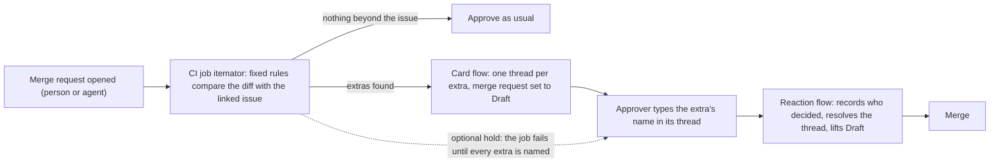

# Itemator

**One click for what was asked. A name for anything more.**

**Itemator is a GitLab CI job plus two Duo flows. It lists what a merge request changed beyond its linked issue and asks the person who decides to type a name for each extra the rules find, instead of one click for the whole change.**

A team can go one step further: only the person who wrote the linked issue can keep an extra, and GitLab's own merge box waits until they have.

Anthropic's source-control team saw the changes merged per day in its monorepo grow from around 2500 <!-- from: results/external_figures.json:anthropic_merges_per_day_may_2026.value --> in May 2026 to over 30000 <!-- from: results/external_figures.json:anthropic_merges_per_day_september_2026.value --> in September, and writes: "The bottleneck, now, is all of the developer infrastructure built for human scale: source control, builds, and CI." ([Redesigning source control at Anthropic](https://www.anthropic.com/engineering/redesigning-source-control), published 2026-10-13; the page is about their own version control system and does not mention merge requests). A merge request is part of that infrastructure, and the approval at its end was built for human scale too.

When an AI agent or a new teammate opens a merge request, someone approves it, often with one click. Anthropic reports that Claude Code users approve 93% <!-- from: results/external_figures.json:approval_rate_claude_code_permission_prompts.value --> of permission prompts, and calls the result approval fatigue ([source](https://www.anthropic.com/engineering/claude-code-auto-mode)). A merge request has the same problem: the change that was asked for is easy to check, and the extras that came with it are not.

Itemator lists what a merge request changed beyond its linked issue, and asks a person to name each extra before it merges. Changes that stay inside the issue keep the normal one-click approval. Other tools already flag out-of-scope changes (see Related tools); here each extra gets its own thread, a typed answer, and a record of who decided.

**On a real agent.** We gave GitLab's own Developer Flow the issue "make the itemator job faster". It changed only `.gitlab-ci.yml`, a file the issue never mentions. Itemator opened a thread on that file, the approver typed its name, and the flow recorded who kept it.

**See one run without running anything:** [a real run, note by note](results/a_real_run.md), copied from GitLab.

**With auto-merge armed.** The organisers' reference app lifts Draft and arms auto-merge from a CI job, inside the pipeline, before any card exists. With the project's optional hold on, we armed auto-merge while the first pipeline was still running: the `itemator` job failed on purpose (it says an extra is not named yet), GitLab kept the merge blocked, the card posted its thread, the approver typed the name, and after one retry of the `itemator` job GitLab merged the merge request by itself. Without the hold, a thread that is already open also holds the merge (`discussions_not_resolved`), but a merge armed before the card exists can go through first. The retry is a manual click, and it needs "Pipelines must succeed" on in the project (one run, one project).

**Why Duo flows and not only CI.** The CI job finds the extras with fixed rules, so no model decides whether one exists. A CI job cannot talk to a person: it cannot open a thread on the line, read a typed reply, resolve the thread, or move a change into its own merge request. The two Duo flows do that, and only that. **What no flow is told to do:** approve, merge, or push to the target branch. Its only commits are a `split` or `remove` on the merge request's own branch and a branch for one `always` line, each asked for by a typed answer. That limit is in the flow's prompt, which our tests read, not a GitLab permission. GitLab's staff told us a flow's approval counts as the person who started it, so we removed the one approval step we had; a person still approves.

**Status:** built for GitLab's *Life After Code* hackathon (Path A, Supervised). Every figure written in digits that comes from our own runs sits next to a pointer to the results file that produced it, and a CI check (`tools/hardcode_audit.py`) enforces that.

## At a glance
| What we checked | Result | Where |
|---|---|---|
| Does the card flag real extras in agent pull requests? | On five held-out samples, 18 <!-- from: results/precision_audits.json:held_out_pooled.prs_with_real_strict --> of the 36 <!-- from: results/precision_audits.json:held_out_pooled.prs_flagged --> flagged pull requests held a clear extra (labels by one model; limits below) | [results/precision_audits.json](results/precision_audits.json) |
| What does GitLab's own Developer Flow do with it? | Eight issues written first, eight merge requests; the rules found 0 <!-- from: results/field_study.json:extras --> extras | [results/field_study.json](results/field_study.json) |
| Can only the person who wrote the issue keep an extra? | Six pre-registered replies, two accounts, run twice: 12 <!-- from: results/asker_study.json:as_expected --> of 12 <!-- from: results/asker_study.json:cases --> answers ended as expected (the second account is the author's own second account, disclosed) | [results/asker_study.json](results/asker_study.json) |
| Does the reaction flow read typed replies as intended? | 8 <!-- from: results/react_study.json:as_expected --> of 8 <!-- from: results/react_study.json:cases --> pre-registered replies ended as expected (one run) | [results/react_study.json](results/react_study.json) |
| Do hostile words steer the flows? | Hostile text in the issue, description, commit message and a file name, and hostile replies in threads: 6 <!-- from: results/injection_study.json:safety_rules_held --> of 6 <!-- from: results/injection_study.json:safety_rules --> safety rules held in one pre-registered run (one thread was never made, so that reply is untested; the first run was invalid and is kept) | [docs/measurements.md](docs/measurements.md) |
| What does a run cost? | A card run makes about 9 <!-- from: results/cost_per_run.json:card_run_tool_calls.typical --> tool calls, a reaction run 4 <!-- from: results/cost_per_run.json:react_run_tool_calls.min --> to 26 <!-- from: results/cost_per_run.json:react_run_tool_calls.max -->; at 0.13 <!-- from: results/cost_per_run.json:credits_per_tool_call.low --> to 0.18 <!-- from: results/cost_per_run.json:credits_per_tool_call.high --> GitLab Duo credits per call (our meter, one account; an estimate) the hackathon's cap of 500 <!-- from: results/cost_per_run.json:monthly_cap_per_user --> GitLab Duo credits per user and month covers many merge requests. The CI job and the rules call no model | [results/cost_per_run.json](results/cost_per_run.json) |
| Are the rules tested? | Mutation tests, run by a manual GitLab CI job: every mutant is caught; unit tests run in every pipeline | [results/mutation.json](results/mutation.json) |
| Does it hold a merge? | An open thread holds it; with the optional hold, a merge armed inside the pipeline waits for the names (run live in the old order and again under the policy). The check is injected by a pipeline execution policy, so a merge request cannot remove it: 0 <!-- from: results/bypass_matrix_v2.json:merged --> of 11 <!-- from: results/bypass_matrix_v2.json:attempts --> bypass attempts merged (before the policy, 2 <!-- from: results/bypass_matrix.json:merged --> of 8 <!-- from: results/bypass_matrix.json:attempts --> did); see the hold step in [docs/how-it-works.md](docs/how-it-works.md) | [Known limits](#known-limits) |
| Which stages? | Plan, Create and Verify in earnest; Package, Secure, Configure and Govern modestly; Release with a deployment job, a page and a release section; Monitor only as a report on past decisions (not a service monitor) | [stage table](#which-lifecycle-stages-it-touches) |

## How it works

1. **A CI job lists the extras.** The `itemator` job reads the merge request's diff and its linked issue and applies fixed rules (`itemator/extras.py`): a new dependency, a CI or config change, removed tests, a removed public function, deleted generated code, a committed binary, large file or build output, a version bump, a stray file. No model decides whether an extra exists. It writes `itemator.json`.
2. **A GitLab Duo flow posts the card.** `flows/itemator_card.yml` starts by itself when the pipeline of a merge request a person opened finishes. In our runs GitLab did not start the flow from the pipeline of a merge request an agent opened, and its [trigger documentation](https://docs.gitlab.com/user/duo_agent_platform/triggers/) says why: every trigger needs a human to perform the action, and a bot or service account cannot start one. So for such a merge request, a person assigns the card account as reviewer, which is a normal reviewer step. The card is two lines: what is beyond the issue, and what the approver does next. Each extra gets its own resolvable thread on the line it changed, and the merge request is set to Draft.
3. **The approver answers in the thread** with one word each: the extra's exact name keeps it, `not an extra` dismisses it, `split` moves a CI or config file or a package manifest into its own merge request, `remove` takes it back out of this one (like `split`, only for whole CI or config files, or a manifest whose only change is the named package; `remove` also takes back a file the merge request adds). The thread offers only the answers the flow accepts for that extra. `flows/itemator_react.yml` reads the answers when someone mentions its account or marks the merge request ready. It records who typed what, reopens a thread that was resolved without a name, and takes Draft off when every extra is settled. Its summary lists each extra with who decided, and says so when the author typed every answer.
The remaining steps (registry facts, the description sentence, `always`, the optional hold, the asker rule, the decision log, the skills) and the live runs are in [docs/how-it-works.md](docs/how-it-works.md); the measurements and their limits are in [docs/measurements.md](docs/measurements.md). To install it in your own project, see [docs/setup.md](docs/setup.md).

## Related tools
Other tools already flag changes beyond the ask. As their own pages describe them on 2026-10-11, none asks the approver to name each extra inside GitLab:
- CodeRabbit checks a pull request against its linked issue and can block ([pre-merge checks](https://docs.coderabbit.ai/pr-reviews/pre-merge-checks)).
- unasked compares a change with the agent's prompt ([PyPI](https://pypi.org/project/unasked/)); MergeWarden compares it with declared paths ([Product Hunt](https://www.producthunt.com/products/mergewarden)).
- GitLab's own Code Review Flow reviews a merge request from its title, description and diff ([docs](https://docs.gitlab.com/user/duo_agent_platform/flows/foundational_flows/code_review/)).

Itemator's claim is narrower than detection: one thread per extra, a typed name, in GitLab, against the linked issue.

## Which lifecycle stages it touches
We count a stage only where Itemator reads or writes something in it:

| Stage | What Itemator does there |
|---|---|
| Plan | Reads the linked issue and checks the change against what it says |
| Create | Reviews the merge request, opens one thread per extra, moves or removes an extra |
| Verify | Runs as a CI job on every merge request pipeline; starts a Duo flow when it finishes |
| Package | Looks up new dependencies on their public registries; a deployment job also uploads the checker to this project's package registry |
| Secure | Shows advisories and licences for new dependencies; flags committed binaries and build output |
| Configure | Reads a team policy from the target branch; the flows and skills are set up per project |
| Govern | Records who decided each extra; the policy can require a second person |
| Release | Every push to the default branch records a deployment of a `production` environment, uploads the checker as a package version, and publishes a page of what shipped in it (only merge requests are listed; a commit pushed straight to the branch has none): the merge requests, their extras and who named each ([live page](https://showcase-3cd72e.gitlab.io/), written by `itemator/shipped.py` from GitLab's own deployment records); on a tag, the `decision-log` job writes the same kind of section into that release's description |
| Monitor | The same job, run by hand for any window, reports how extras were decided (kept, dismissed, moved, removed) and how many names the merge request's own author typed alone. It watches the review process, not a running service |

That touches each of the nine stages the organisers list, and we claim no more than the table says. Monitor is the thinnest: one read-only report. Release is a package upload, a deployment record and a generated page, added on 2026-10-15. Monitor is not a monitor of running software: nothing here watches a deployed service.

## Known limits
- **The flow triggers are switched off outside our own runs.** Each run uses Duo usage that is billed to the project, so a visitor who opens a merge request here will not see a card; the video and the results files show full runs. We re-check the hackathon rule on self-running flows before switching them back on after the deadline.
- **The lock is a project setting.** Each extra is a resolvable thread, and the merge button stays blocked while a thread is open only if the project turns on "All threads must be resolved". In this project it is on (an organiser updated our role and we turned it on): we checked that a merge with an open thread is refused ("discussions not resolved") and goes through once the threads are answered. Our role cannot change that setting through the API, so another team has to tick it itself; without it an unnamed extra only puts the merge request in Draft. A person's own comment that mentions the reaction flow also becomes a thread, so the flow resolves it at the end of its run. We tested auto-merge on a throwaway branch with a thread already open: GitLab kept the merge at `discussions_not_resolved`, and after the name was typed it merged by itself within two seconds, with no other click. The reference app arms the merge inside the pipeline, before any thread exists: only the optional hold, described in [docs/how-it-works.md](docs/how-it-works.md), covers that order, and it was run live twice, the second time with the job injected by the policy. A `split` or `remove` adds a commit to the branch, which GitLab's documentation says cancels an armed auto-merge until it is armed again.
- **The check lives in a policy.** A merge request that rewrites the `itemator` job can hide its extras. The job is injected by a pipeline execution policy that the merge request cannot edit (the organisers added the policy-link ability to our role on 2026-10-14). We ran GitLab's Developer Flow once on an issue we wrote first: the merge request it opened got the injected job, and the job passed (policy_job_in_agent_pipeline in [results/policy_run.json](results/policy_run.json)). Anyone who can push to the default branch can still change the checker (`itemator/` here, which the job runs from the target branch), and so can a flow account that holds `create_commit`; the job file itself is kept in the policy project, which the flow accounts cannot push to, and the job `policy-job-in-sync` fails when the copy here differs from it. Protecting the branch needs a role we do not have. Another project needs that ability or an Owner, and GitLab's copy of a policy lags a few minutes behind its policy project.
- **Author-typed names.** A solo author can type every name. The summary says when that happened, instead of hiding it. With `other_person_required` in the team policy, the author's own replies do not count; we tested that a second account's replies do.
- **Rules miss things.** For example, a one-line edit of a dependency list in `pyproject.toml` was missed until a live test found it (fixed in rules v4). The audits list more.
- **The approved event is untested.** The flow can react when a merge request is approved, but a second approver is needed to test it, and we have not.
- **No hook on merge.** GitLab's merge trigger is off by default, so no record is written at the moment of merging; the summary note lists who named what once the last extra is settled.
- **Split and remove are narrow.** Both take whole CI or config files, or a manifest whose only change is the named package; remove also takes back a file the merge request adds. Anything else is refused with a reason.
- **Anyone who can comment can answer.** On a public project any GitLab user can type a name or `not an extra`; only `split` and `remove` are limited to the author, assignees and reviewers.
- **A model follows the reaction steps.** Code decides which extras exist; the Duo model checks replies with the fixed string tests in `flows/itemator_react.yml`. It passed our live tests. We also wrote eight replies down first ([eval/react_study_cases.json](eval/react_study_cases.json): an exact name, a name in backticks with a full stop after a wrong reply, a dismissal, `remove`, a name in upper case, another thread's name, an instruction aimed at the flow, a name typed with the mention) and ran them once on a throwaway merge request: the flow ended as expected on 8 <!-- from: results/react_study.json:as_expected --> of 8 <!-- from: results/react_study.json:cases -->, including the three that had to stay open. A first list of thirteen, which also held a question and "keep it", was replaced before any run because the rules put stray files in one thread; a second round on a newer version of the flow put those two cases back and ended as expected on 8 <!-- from: results/react_study_round2.json:as_expected --> of 8 <!-- from: results/react_study_round2.json:cases -->. That is one run of one model on cases we wrote, so it is not a misread rate ([results/react_study.json](results/react_study.json)).
- **Typing is not reading.** We have not measured whether typing a name changes what approvers do. What it changes for certain is the record: each extra says who kept it. Recall is not measured either, only precision.

## Why Python
We checked whether Itemator should be written in Rust, Go, TypeScript or C++ instead. We kept Python: speed is not the problem, and a rewrite would cost most of our remaining time for no change in any result. Research agents scored each rewrite; those scores and day estimates are model estimates, not measurements ([docs/why-python.md](docs/why-python.md), `results/language_study.json`).

On the 180 <!-- from: results/timing_rules.json:prs_timed --> real agent changes we replayed, the rules take a median of 0.48 <!-- from: results/timing_rules.json:median_ms --> thousandths of a second per change, and 0.39 <!-- from: results/timing_rules.json:total_s --> seconds for all of them. The full reasoning, with every number traced to a file, is in [docs/why-python.md](docs/why-python.md).

## Licence
MIT. See [LICENSE](LICENSE). The evaluation uses the AIDev dataset (CC BY 4.0), fetched by script and not redistributed; see [NOTICE](NOTICE).
