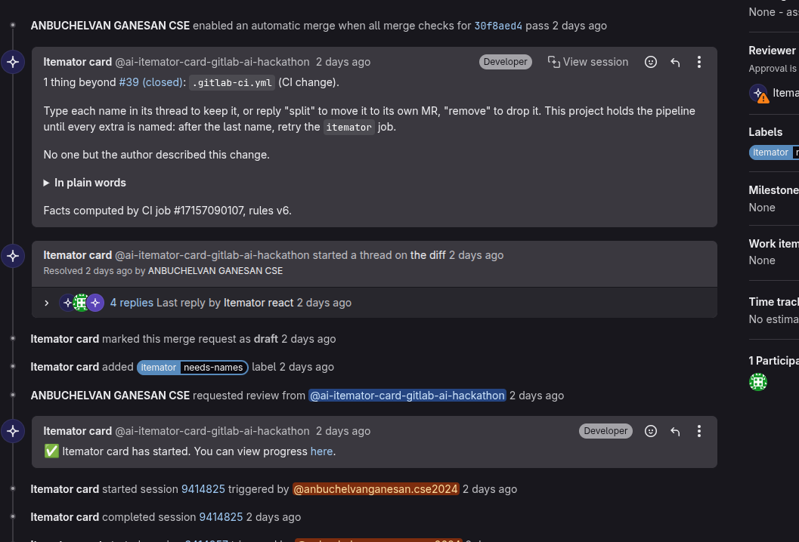
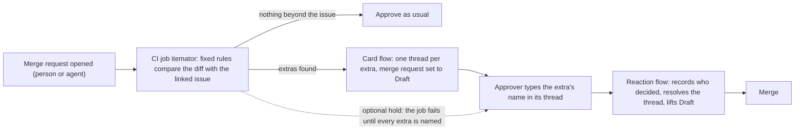

# Itemator

**An extra is a change a merge request makes that its issue never asked for, such as a new dependency. Itemator lists the extras, and none of them goes in until a person types an answer.**

*Life After Code, Path A, Assisted (a person approves every step).* A CI job finds the extras. A GitLab Duo flow posts one short card and opens one thread per extra. A person keeps an extra by typing its name, or moves it out with `split` or `remove`, and a person still approves the merge request. There are no line-by-line comments: besides the card and the threads, Itemator only answers replies and sums up at the end.

A CI job compares a merge request with its linked issue and lists the extras: the changes the issue did not ask for, such as a new dependency, a CI or config file, deleted tests, a binary file, or a file that instructs coding agents. A GitLab Duo flow then opens one comment thread per extra and sets the merge request to Draft, which GitLab will not merge. The reviewer answers in the thread: the extra's name keeps it, `split` or `remove` moves it out, and a second Duo flow reads the answer, acts on it and records who decided. The CI job's rules use no AI model.

Why Duo flows and not only CI: a CI job runs when code is pushed and cannot wait for a reviewer's reply; the second flow starts when its account is mentioned on the merge request and then reads what people typed. Changes that stay inside the issue keep one-click approval. GitLab asks contributors for "only one specific issue" per merge request ([contribution criteria](https://docs.gitlab.com/development/contributing/merge_request_workflow/)); Itemator targets that rule and does not enforce it. It works the same on a change a person wrote and one an agent wrote, and it runs on your own machine with no GitLab and no model: `python -m itemator.local --issue issue.txt`, or, for an agent's local commits with no issue, `python -m itemator.local --commits --map`, which also lists every changed file with the reason it was or was not flagged ([how](docs/how-it-works.md)).

**A real example.** In July 2025 GitHub Copilot opened a pull request in the Model Context Protocol's C# SDK to fix one deserialization bug, and also committed `dotnet-install.sh`, an install script the task never mentioned; a maintainer wrote "`@copilot` this file looks unnecessary, please delete it" ([the comment](https://github.com/modelcontextprotocol/csharp-sdk/pull/645#discussion_r2225905461)). The rules, frozen on 12 October, a week before we read any outcome, list that file on their own. It is one of 24 <!-- from: results/real_catches_v1.json:summary.read --> files in public agent pull requests where a reviewer objected in an inline comment and the rules list the file; [results/real_catches.md](results/real_catches.md) lists every one with the reviewer's words and what the rules say, including the 8 <!-- from: results/real_catches_v1.json:summary.landed_with_the_file --> that landed anyway. The reviewer's objection came a median of 4.5 <!-- from: results/catch_timing_v1.json:summary.median_hours --> hours after the pull request opened ([results/catch_timing_v1.json](results/catch_timing_v1.json)).

**One answer from outside the project.** Every other answer here came from the owner's accounts. On !278 we asked one person who had not seen the project (they made a GitLab account for it; the rules, written before the card, are in [eval/outside_answer_rubric.json](eval/outside_answer_rubric.json)). They kept the extra and said why in their own words: [their reply](https://gitlab.com/gitlab-ai-hackathon/transcend-october-2026/39194174/showcase/-/merge_requests/278#note_4055666063), [the note on the issue](https://gitlab.com/gitlab-ai-hackathon/transcend-october-2026/39194174/showcase/-/issues/81). Raw record: [results/outside_answer_live.json](results/outside_answer_live.json).

**Check it yourself, no login needed.** One live run, on GitLab as it happened (merge request !249, kept as a record and never merged; its pipeline fails on a licence check because the extra is a BSD-licensed package):
1. [The card](https://gitlab.com/gitlab-ai-hackathon/transcend-october-2026/39194174/showcase/-/merge_requests/249#note_4051994057): one thing beyond the issue, a new dependency.
2. [Its thread](https://gitlab.com/gitlab-ai-hackathon/transcend-october-2026/39194174/showcase/-/merge_requests/249#note_4051994420): what the package brings along, and its weight.
3. [The person's answer](https://gitlab.com/gitlab-ai-hackathon/transcend-october-2026/39194174/showcase/-/merge_requests/249#note_4051997997): the extra's name, and on the next line why it stays. Our test script ([eval/weight_live.py](eval/weight_live.py)) posted it from the project owner's account, so the flow saw a reply from a person; it was not typed by hand.
4. [The flow's reply](https://gitlab.com/gitlab-ai-hackathon/transcend-october-2026/39194174/showcase/-/merge_requests/249#note_4052004427) and [its summary](https://gitlab.com/gitlab-ai-hackathon/transcend-october-2026/39194174/showcase/-/merge_requests/249#note_4052005717): kept, and by whom.
5. [The note on the issue](https://gitlab.com/gitlab-ai-hackathon/transcend-october-2026/39194174/showcase/-/issues/79#note_4052006585): what went beyond the issue, and who decided.

Two more runs, note by note: [results/a_real_run.md](results/a_real_run.md) and, starting from an agent's merge request, [results/a_real_agent_run.md](results/a_real_agent_run.md). The flow triggers are off outside our own runs, so a merge request a visitor opens here gets no card ([why](#known-limits)).

### In numbers

| Question | Answer |
|---|---|
| Have real reviewers objected to files an AI agent changed that the rules also name? | Yes: 24 <!-- from: results/real_catches_v1.json:summary.pairs --> files in public agent pull requests, named by rules frozen a week before we read any outcome; 16 <!-- from: results/real_catches_v1.json:summary.did_not_land --> of those files did not land ([every case](https://showcase-3cd72e.gitlab.io/catches/)) |
| Does it stay quiet when there is nothing to ask? | On merge requests GitLab's own Duo Developer Flow merged into gitlab-org/gitlab in September 2026, it spoke on 9 <!-- from: results/public_replay_a1.json:G.agent.flagged --> of 84 <!-- from: results/public_replay_a1.json:G.agent.scored --> and stayed silent on the rest ([replay](results/public_replay_a1.json)); across public agent pull requests it lists an extra on 10,712 <!-- from: results/aidev_population_v6.json:summary.overall.with_an_extra --> of 71,582 <!-- from: results/aidev_population_v6.json:summary.readable --> ([population](results/aidev_population_v6.json)) |
| What does a merge request cost? | The check job makes no model call; the card flow makes about 6 <!-- from: results/cost_per_run.json:card_run_model_calls.typical --> ([cost](results/cost_per_run.json)) |

Every other number, with what it does not show, the real runs and each check the card can add: [docs/measurements.md](docs/measurements.md#the-front-pages-numbers-in-full).

**What it looks like.** The card is the picture near the top (fixed two lines, then one thread on the changed line). Here, a pipeline where the `itemator` job comes from a policy, not from the project's own CI file (the shield badge).

## How it works

1. **A CI job lists the extras.** The `itemator` job reads the merge request's diff and its linked issue and applies fixed rules (`itemator/extras.py`): a new dependency, a CI or config change, removed tests, a removed public function, deleted generated code, a committed binary, large file or build output, a version bump, a stray file. No model decides whether an extra exists. It writes `itemator.json`.
2. **A GitLab Duo flow posts the card.** `flows/itemator_card.yml` starts by itself when the pipeline of a merge request a person opened finishes. In our runs GitLab did not start the flow from the pipeline of a merge request an agent opened, and its [trigger documentation](https://docs.gitlab.com/user/duo_agent_platform/triggers/) says why: every trigger needs a human to perform the action, and a bot or service account cannot start one. So for such a merge request, a person assigns the card account as reviewer, which is a normal reviewer step. The card is two lines: what is beyond the issue, and what the approver does next. Each extra gets its own resolvable thread on the line it changed, and the merge request is set to Draft.
3. **The approver answers in the thread** with one word each: the extra's exact name keeps it, `not an extra` dismisses it, `split` moves a CI or config file or a package manifest into its own merge request, `remove` takes it back out of this one (like `split`, only for whole CI or config files, or a manifest whose only change is the named package; `remove` also takes back a file the merge request adds). The thread offers only the answers the flow accepts for that extra. `flows/itemator_react.yml` reads the answers when someone mentions its account or marks the merge request ready. It records who typed what, reopens a thread that was resolved without a name, and takes Draft off when every extra is settled. Its summary lists each extra with who decided, and says so when the author typed every answer. It also leaves a note on the issue the merge request closes, listing each extra and who decided it, so the plan records what was done beyond it ([issue #79](https://gitlab.com/gitlab-ai-hackathon/transcend-october-2026/39194174/showcase/-/issues/79), from the live run of 2026-10-20; also [#75](https://gitlab.com/gitlab-ai-hackathon/transcend-october-2026/39194174/showcase/-/issues/75) and [#55](https://gitlab.com/gitlab-ai-hackathon/transcend-october-2026/39194174/showcase/-/issues/55)).
The remaining steps (registry facts, the description sentence, `always`, the optional hold, the asker rule, the decision log, the skills) and the live runs are in [docs/how-it-works.md](docs/how-it-works.md); the measurements and their limits are in [docs/measurements.md](docs/measurements.md). To install it in your own project, see [docs/setup.md](docs/setup.md).

## The first run, the numbers and the design in more detail

**The honest number.** In September 2026, 149 <!-- from: results/public_replay_a1.json:G.merge_requests --> merge requests that GitLab's Developer Flow had opened were merged into gitlab-org/gitlab. We ran Itemator on them read-only, with the plan written down before the run, and posted nothing. For 84 <!-- from: results/public_replay_a1.json:G.agent.scored --> of them we could read both the issue and the agent's own version of the change. Itemator would have listed extras on 9 <!-- from: results/public_replay_a1.json:G.agent.flagged -->. Two AI models (Claude Sonnet and Claude Opus, so not independent of us) judged those 9 <!-- from: results/public_replay_a1.json:G.agent.flagged --> without seeing the rules' output: both agreed there was a clear extra in 0 <!-- from: results/public_replay_labels.json:per_merge_request.G_flagged.strict -->, and on 2 <!-- from: results/public_replay_labels.json:per_merge_request.G_flagged.lenient --> at least one of them called an extra borderline or real. Most of the 37 <!-- from: results/public_replay_flag_tests.json:G_agent_flagged.extras --> extras listed (24 <!-- from: results/public_replay_flag_tests.json:G_agent_flagged.tests_naming_a_deleted_flag -->) were tests that mention a feature flag the same merge request deletes, which [GitLab's own docs](https://docs.gitlab.com/development/feature_flags/controls/) ask for, so the cost was one typed reply each. Each of those 24 <!-- from: results/flag_fact_replay_v1.json:G_agent_flagged.with_the_flag_fact --> threads now says so: it names the feature flag whose definition the change deletes, so the reviewer can see at a glance why the tests went, and on 4 <!-- from: results/flag_fact_replay_v1.json:G_agent_flagged.merge_requests_where_every_extra_has_it --> of the 9 merge requests that covers every extra. The rules are unchanged; we added this sentence after seeing these cases ([eval/flag_fact_replay.py](eval/flag_fact_replay.py)). **What we have not shown:** that the card changes what a reviewer does. The [24 real cases](results/real_catches.md) show the rules list files reviewers objected to, but none of those reviewers saw a card, and on GitLab's own agent merge requests the rules found no clear extra. What we measured and what we could not is in [docs/measurements.md](docs/measurements.md); the results for people's and community merge requests are in the table below, apart from the agents'.

When an AI agent or a new teammate opens a merge request, someone approves it, often with one click. Anthropic reports that Claude Code users approve 93% <!-- from: results/external_figures.json:approval_rate_claude_code_permission_prompts.value --> of permission prompts, and calls the result approval fatigue ([source](https://www.anthropic.com/engineering/claude-code-auto-mode)). A merge request has the same problem: the change that was asked for is easy to check, and the extras that came with it are not.

**Run it on your own history:** the manual `scan-history` job reads your last fifty merged merge requests and writes the same report, before you change anything (the [job on this project](https://gitlab.com/gitlab-ai-hackathon/transcend-october-2026/39194174/showcase/-/jobs/17231250573): of 15 <!-- from: results/scan_history_run.json:summary.with_an_issue --> merged merge requests that link an issue, 3 <!-- from: results/scan_history_run.json:summary.with_extras --> held an extra).

**With auto-merge armed.** A CI job can arm auto-merge inside the pipeline, before any card exists. With the project's optional hold on, we armed auto-merge while the first pipeline was still running: the `itemator` job failed on purpose (it says an extra is not named yet), GitLab kept the merge blocked, the card posted its thread, the approver typed the name, and after one retry of the `itemator` job GitLab merged the merge request by itself. Without the hold, a thread that is already open also holds the merge (`discussions_not_resolved`), but a merge armed before the card exists can go through first. The retry is a manual click, and it needs "Pipelines must succeed" on in the project (one run, one project).

**Its own footprint, measured and cut.** A tool that warns about dependencies nobody asked for, because they make every install heavier, should keep its own install small. GitLab starts a fresh, sealed machine for each check and downloads the box it runs in (an image) plus git. We measured that, then changed it twice: the full Python image is 411.6 <!-- from: results/alpine_trial_v1.json:images.full.image_mb --> MB, the slim one 43.3 <!-- from: results/alpine_trial_v1.json:images.slim.image_mb --> MB plus 23.8 <!-- from: results/alpine_trial_v1.json:images.slim.git_mb_per_run --> MB of git on every run, and the Alpine one the check runs on now 20.6 <!-- from: results/alpine_trial_v1.json:images.alpine.image_mb --> MB plus 9.8 <!-- from: results/alpine_trial_v1.json:images.alpine.git_mb_per_run --> MB of git. On a merge request with two extras, the Alpine and slim jobs listed the same two, and the Alpine job's own log ran 20.8 <!-- from: results/alpine_trial_v1.json:jobs.alpine-trial.log_seconds --> s against 34.8 <!-- from: results/alpine_trial_v1.json:jobs.itemator.log_seconds --> s ([results/alpine_trial_v1.json](results/alpine_trial_v1.json); carbon before and after in [docs/measurements.md](docs/measurements.md)). Less to download and less runner time means less electricity per check. On a runner that already holds the image, the old full image needed no git download, so there the saving is less clear.

**Why Duo flows and not only CI.** The CI job finds the extras with fixed rules, so no model decides whether one exists. A CI job runs when code is pushed, not when a person replies: given a token it could post a thread, but it cannot wait for the answer and act on it, and our job has only GitLab's job token, which cannot post on a merge request at all. The two Duo flows start on GitLab events (a merge request's finished pipeline, a reviewer assignment, a mention, marking the merge request ready), open the threads on the lines, read the typed replies, resolve the threads and move a change into its own merge request, and only that. **What no flow is told to do:** approve, merge, or push to the target branch. Its only commits are a `split` or `remove` on the merge request's own branch and a branch for one `always` line, each asked for by a typed answer. That limit is in the flow's prompt, which our tests read, not a GitLab permission. GitLab's documentation says a flow's activity is attributed to the person who started it ([composite identity](https://docs.gitlab.com/user/duo_agent_platform/composite_identity/)), and GitLab's staff told us in the hackathon's Discord channel (not public) that this includes approval, so we removed the one approval step we had; a person still approves.

## Why now
Anthropic's source-control team saw the changes merged per day in its monorepo grow from around 2500 <!-- from: results/external_figures.json:anthropic_merges_per_day_may_2026.value --> in May 2026 to over 30000 <!-- from: results/external_figures.json:anthropic_merges_per_day_september_2026.value --> in September, and writes: "The bottleneck, now, is all of the developer infrastructure built for human scale: source control, builds, and CI." ([Redesigning source control at Anthropic](https://www.anthropic.com/engineering/redesigning-source-control), published 2026-10-13; the page is about their own version control system and does not mention merge requests). A merge request is part of that infrastructure, and the approval at its end was built for human scale too.

How often are agent changes accepted? In the public AIDev dataset (over 456,000 <!-- from: results/external_figures.json:aidev_agent_pull_requests.value --> agent pull requests; [Li et al.](https://arxiv.org/abs/2507.15003)), on its popular-repository subset, 76.8% <!-- from: results/external_figures.json:aidev_human_pull_requests_merged.value --> of human pull requests were merged, against 65.3% <!-- from: results/external_figures.json:aidev_codex_pull_requests_merged.value --> for OpenAI Codex and 38.2% <!-- from: results/external_figures.json:aidev_copilot_pull_requests_merged.value --> for GitHub Copilot. A reviewer is deciding on a lot of work that ends up turned down, and does it with the same approve click as for anything else. That is the burden this tool is meant to lighten; the data does not say how many of the rejections were scope creep.

Outside code, people describe the same thing when an AI does more than it was asked. Rob Pike, after AI agents sent him a thank-you email that no person had read first: "I can't remember the last time I was this angry." ([Simon Willison's write-up](https://simonwillison.net/2025/Dec/26/slop-acts-of-kindness/)) Summer Yue told her agent to confirm before acting and watched it delete her inbox ([ForkLog](https://forklog.com/en/news/openclaw-ai-agent-runs-amok-deletes-meta-researchers-emails)). The card arrives unasked too, so its words are about the change, never the person: in a preprint, help that arrives before it is asked for made people feel more threatened and less willing to use it ([Harari and Amir, on arXiv](https://arxiv.org/abs/2509.09309)). Every card with extras says "An extra can be welcome; it just needs one person's choice.", and a change whose issue has the same author is described as missing a second reader, not as a fault. In two scenario-based experiments (one preregistered), help from an AI that came before anyone asked for it made people feel more threatened and less willing to use the tool ([Harari and Amir, a preprint](https://arxiv.org/abs/2509.09309)). What these share is an extra nobody chose, arriving before anyone could say no. Itemator keeps, moves or removes nothing until a person replies, and the decision log and the [What shipped](https://showcase-3cd72e.gitlab.io/) page count the extras that were merged without a recorded answer. Review is a conversation, so a reply that keeps an extra can say why on the lines under its name; the decision log and the What shipped page quote that reason in the person's own words, and nothing is inferred when they give none.

## Related tools
Other tools already flag changes beyond the ask. As their own pages describe them on 2026-10-11, none asks the approver to name each extra inside GitLab:
- CodeRabbit checks a pull request against its linked issue and can block ([pre-merge checks](https://docs.coderabbit.ai/pr-reviews/pre-merge-checks)).
- unasked compares a change with the agent's prompt ([PyPI](https://pypi.org/project/unasked/)); MergeWarden compares it with a declared scope ([Product Hunt](https://www.producthunt.com/products/mergewarden)).
- e18e's action-dependency-diff comments on a GitHub pull request with how much an npm dependency change adds ([GitHub](https://github.com/e18e/action-dependency-diff)). Itemator's weight line does the same kind of measuring for PyPI and npm, on GitLab, only for a dependency the issue did not ask for, and multiplies it by the project's own pipelines.
- GitLab's own Code Review Flow reviews a merge request from its title, description and diff ([docs](https://docs.gitlab.com/user/duo_agent_platform/flows/foundational_flows/code_review/)).

Itemator's claim is narrower than detection: one thread per extra, a typed name, in GitLab, against the linked issue.

## Which lifecycle stages it touches
We count a stage only where Itemator reads or writes something in it:

| Stage | What Itemator does there | Open it |
|---|---|---|
| Plan | Reads the linked issue and checks the change against what it says | [the issue a card read](https://gitlab.com/gitlab-ai-hackathon/transcend-october-2026/39194174/showcase/-/issues/39) |
| Create | Reviews the merge request, opens one thread per extra, moves or removes an extra | [a merge request with its card, thread and summary](https://gitlab.com/gitlab-ai-hackathon/transcend-october-2026/39194174/showcase/-/merge_requests/45) |
| Verify | Runs as a CI job on every merge request pipeline; starts a Duo flow when it finishes. The same job also writes the extras as GitLab Code Quality findings (severity info, on each thread's line) and a Metrics report (`itemator/glreports.py`) | [pipelines](https://gitlab.com/gitlab-ai-hackathon/transcend-october-2026/39194174/showcase/-/pipelines), [the job's log](https://gitlab.com/gitlab-ai-hackathon/transcend-october-2026/39194174/showcase/-/jobs/17265337254) |
| Package | Looks up new dependencies on their public registries (PyPI, npm, crates.io, the Go module proxy; NuGet for packages added in .NET project files, shown beside the extras); a deployment job also uploads the checker to this project's package registry | [package registry](https://gitlab.com/gitlab-ai-hackathon/transcend-october-2026/39194174/showcase/-/packages) |
| Secure | Shows advisories and licences for new dependencies; flags committed binaries and build output; GitLab's secret detection and SAST templates run on every merge request pipeline; the card's own checks name lines of shapes that have carried attacks and strangers' text run in CI (on 31 <!-- from: results/advisory_holdout_v2.json:cases --> published advisories set aside before the rule was written, its first version named 10 <!-- from: results/advisory_holdout_v1.json:caught --> and its second version, written after we knew that result, 15 <!-- from: results/advisory_holdout_v2.json:caught -->) | [held-out advisory replay](results/advisory_holdout_v2.json), [SAST job](https://gitlab.com/gitlab-ai-hackathon/transcend-october-2026/39194174/showcase/-/jobs/17266699652) |
| Configure | Reads a team policy from the target branch; the flows and skills are set up per project; the deploy job runs in a `resource_group` (two merges deploy one after the other) and reads a variable scoped to the `production` environment | [team policy file](.itemator.toml), [deploy log](https://gitlab.com/gitlab-ai-hackathon/transcend-october-2026/39194174/showcase/-/jobs/17266699659) |
| Govern | Records who decided each extra; the policy can require a second person. The check itself is injected by a pipeline execution policy, so a merge request cannot edit or skip it (a push straight to the default branch still can; see [Known limits](#known-limits)): 0 <!-- from: results/bypass_matrix_v2.json:merged --> of 11 <!-- from: results/bypass_matrix_v2.json:attempts --> bypass attempts merged; 9 <!-- from: results/bypass_matrix_v2.json:blocked_by_the_itemator_job --> were stopped by the check itself and the other two by GitLab refusing a second job with the same name | [bypass attempts](results/bypass_matrix_v2.json), ["triggered by policy" in a job log](https://gitlab.com/gitlab-ai-hackathon/transcend-october-2026/39194174/showcase/-/jobs/17265337254) |
| Release | Every push to the default branch records a deployment of a `production` environment, uploads the checker as a package version, and publishes a page of what shipped in it (only merge requests are listed; a commit pushed straight to the branch has none): the merge requests, their extras and who named each ([live page](https://showcase-3cd72e.gitlab.io/), written by `itemator/shipped.py` from GitLab's own deployment records); the same push rebuilds [the answer log](https://showcase-3cd72e.gitlab.io/answers/) (`itemator/answerlog.py`): every recorded answer, each entry carrying the SHA-256 of the one before, built on the copy the site published last, so a later edit or deletion shows; on a tag, the `decision-log` job writes the same kind of section into that release's description | [release with its decisions](https://gitlab.com/gitlab-ai-hackathon/transcend-october-2026/39194174/showcase/-/releases/v0.1.0-rc1), [live page](https://showcase-3cd72e.gitlab.io/) |
| Monitor | The same job, run by hand for any window, reports how extras were decided (kept, dismissed, moved, removed) and how many names the merge request's own author typed alone. It watches the review process, not a running service. The `scan-history` job runs the same rules over merge requests already merged. After each page publish on the default branch, the `pages-smoke-check` job fetches the published pages and fails if one does not answer | [scan-history run](https://gitlab.com/gitlab-ai-hackathon/transcend-october-2026/39194174/showcase/-/jobs/17231250573), [pages check](https://gitlab.com/gitlab-ai-hackathon/transcend-october-2026/39194174/showcase/-/jobs/17266699661) |

That touches each of the nine stages the organisers list, and we claim no more than the table says. Monitor is the thinnest: one read-only report and a check that the published pages answer. Release is a package upload, a deployment record and a generated page, added on 2026-10-15. After each deployment one job checks that the published pages answer; nothing watches them continuously.

## Known limits
- **Tested on public projects only.** The `itemator` job and `scan-history` read the merge request and its issues through GitLab's API, first without a token and then with the job token. GitLab's job token can read merge requests and their notes but not issues ([job token docs](https://docs.gitlab.com/ci/jobs/ci_job_token/)), so in a private project the issue reads would fail; we have not run it there.
- **The flow triggers are switched off outside our own runs.** Each run uses Duo usage that is billed to the project, so a visitor who opens a merge request here will not see a card; the video and the results files show full runs. They stay off after the submission deadline until the winners are announced, as the hackathon's rules ask.
- **The lock is a project setting.** Each extra is a resolvable thread, and the merge button stays blocked while a thread is open only if the project turns on "All threads must be resolved". In this project it is on (an organiser updated our role and we turned it on; said in the hackathon's Discord channel, which is not public): we checked that a merge with an open thread is refused ("discussions not resolved") and goes through once the threads are answered. Our role cannot change that setting through the API, so another team has to tick it itself; without it an unnamed extra only puts the merge request in Draft. A person's own comment that mentions the reaction flow also becomes a thread, so the flow resolves it at the end of its run. We tested auto-merge on a throwaway branch with a thread already open: GitLab kept the merge at `discussions_not_resolved`, and after the name was typed it merged by itself within two seconds, with no other click. The reference app arms the merge inside the pipeline, before any thread exists: only the optional hold, described in [docs/how-it-works.md](docs/how-it-works.md), covers that order, and it was run live twice, the second time with the job injected by the policy. A `split` or `remove` adds a commit to the branch, which GitLab's documentation says cancels an armed auto-merge until it is armed again.
- **The check lives in a policy.** A merge request that rewrites the `itemator` job can hide its extras. The job is injected by a pipeline execution policy that the merge request cannot edit (the organisers added the policy-link ability to our role on 2026-10-14; said in the hackathon's Discord channel, which is not public). We ran GitLab's Developer Flow once on an issue we wrote first: the merge request it opened got the injected job, and the job passed (policy_job_in_agent_pipeline in [results/policy_run.json](results/policy_run.json)). Anyone who can push to the default branch can still change the checker (`itemator/` here, which the job runs from the target branch), and so can a flow account that holds `create_commit`; the job file itself is kept in the policy project, which the flow accounts cannot push to, and the job `policy-job-in-sync` fails when the copy here differs from it. Protecting the branch needs a role we do not have. Another project needs that ability or an Owner, and GitLab's copy of a policy lags a few minutes behind its policy project.
- **Author-typed names.** A solo author can type every name. The summary says when that happened, instead of hiding it. With `other_person_required` in the team policy, the author's own replies do not count; we tested that a second account's replies do.
- **It does not catch what GitLab's reviewers catch.** On GitLab Duo's own merge requests in gitlab-org/gitlab, the parts people objected to were almost all source code, tests and docs, which the rules have no kind for; the rules listed none of them ([results/gitlab_scope_v6.json](results/gitlab_scope_v6.json)). Itemator names the kinds of change a one-click approval skips (dependencies, CI and config, binaries, generated files, agent instructions); reading the code is still the reviewer's job.
- **The forward test is not read yet.** On 2026-10-21 we sealed 60 <!-- from: results/prospective_v1_sealed.json:summary.pull_requests --> agent pull requests that were open on GitHub, with the 245 <!-- from: results/prospective_v1_sealed.json:summary.listed_files --> files the frozen rules list in them ([results/prospective_v1_sealed.json](results/prospective_v1_sealed.json); the list's SHA-256 is `1281919d8262256d45363f315cc74afe4e54023a4d1e855fba59dc150ed38647`). On 2026-10-25 a script reads whether a reviewer objected to those files, whether they left the pull request, or whether they merged with no objection ([eval/prospective_rubric.json](eval/prospective_rubric.json)). Until then we have no forward result.
- **A word in the issue can hide a dependency.** The rule treats a package as asked for when the issue contains its name, so an issue that says "handle more requests" would hide a new `requests`. An outside reviewer showed this on a test repository. On the 300 <!-- from: results/name_match_v1.json:pull_requests --> held-out agent pull requests it happened 4 <!-- from: results/name_match_v1.json:silenced --> times, and each time the issue did mean the package (for example "Uses azure-appconfiguration-provider"); none was a word used in another sense, so a stricter match would have turned all four into false alarms ([results/name_match_v1.json](results/name_match_v1.json), read by our coding agent, one reader).
- **Rules miss things.** For example, a one-line edit of a dependency list in `pyproject.toml` was missed until a live test found it (fixed in rules v4). The audits list more.
- **The approved event is untested.** The flow can react when a merge request is approved, but a second approver is needed to test it, and we have not.
- **No hook on merge.** GitLab's merge trigger is off by default, so no record is written at the moment of merging; the summary note lists who named what once the last extra is settled.
- **Split and remove are narrow.** Both take whole CI or config files, or a manifest whose only change is the named package; remove also takes back a file the merge request adds. Anything else is refused with a reason.
- **Anyone who can comment can answer.** On a public project any GitLab user can type a name or `not an extra`; only `split` and `remove` are limited to the author, assignees and reviewers.
- **A model follows the reaction steps.** Code decides which extras exist; the Duo model checks replies with the fixed string tests in `flows/itemator_react.yml`. It passed our live tests. We also wrote eight replies down first ([eval/react_study_cases.json](eval/react_study_cases.json): an exact name, a name in backticks with a full stop after a wrong reply, a dismissal, `remove`, a name in upper case, another thread's name, an instruction aimed at the flow, a name typed with the mention) and ran them once on a throwaway merge request: the flow ended as expected on 8 <!-- from: results/react_study.json:as_expected --> of 8 <!-- from: results/react_study.json:cases -->, including the three that had to stay open. A first list of thirteen, which also held a question and "keep it", was replaced before any run because the rules put stray files in one thread; a second round on a newer version of the flow put those two cases back and ended as expected on 8 <!-- from: results/react_study_round2.json:as_expected --> of 8 <!-- from: results/react_study_round2.json:cases -->. That is one run of one model on cases we wrote, so it is not a misread rate ([results/react_study.json](results/react_study.json)).
- **Typing is not reading.** We have not measured whether typing a name changes what approvers do. What it changes for certain is the record: each extra says who kept it. We have not measured how many real problems the rules miss; the table's row on what human reviewers called out of scope counts one kind of miss, and is not a recall figure.

## Where things are
| Folder | What is in it |
|---|---|
| `itemator/` | The checker: the rules, the CI job, the package facts and weights, the decision log and the generated pages |
| `ci/` | The job file the pipeline execution policy injects into every merge request pipeline |
| `flows/` | The two GitLab Duo custom flows: the card and the reaction |
| `skills/` | Two Agent Skills: one for an agent writing a change, one for answering a card |
| `web/` | The pages on GitLab Pages: try a diff, weigh a package, the picture of a change |
| `eval/` | Every study's script, each with the rubric written before it ran |
| `results/` | The output of each study: every number in this README points to one of these files |
| `tests/` | Unit tests, run in every pipeline; the mutation tests run from `eval/mutate_*.py` |
| `tools/` | The hardcode audit, the licence list and a smoke check of the published pages |
| `hf_runner/` | A small runner on a Hugging Face Space that runs the large-dataset studies next to the AIDev dataset |
| `docs/` | Setup, how it works, every measurement with its limits, Google Cloud, and [why the checker stays in Python](docs/why-python.md) |
| `examples/` | A made-up staged change (labelled as such) for the picture of a change, and a sample diff |

## Licence
MIT. See [LICENSE](LICENSE). The evaluation uses the AIDev dataset (CC BY 4.0), fetched by script and not redistributed; see [NOTICE](NOTICE).
