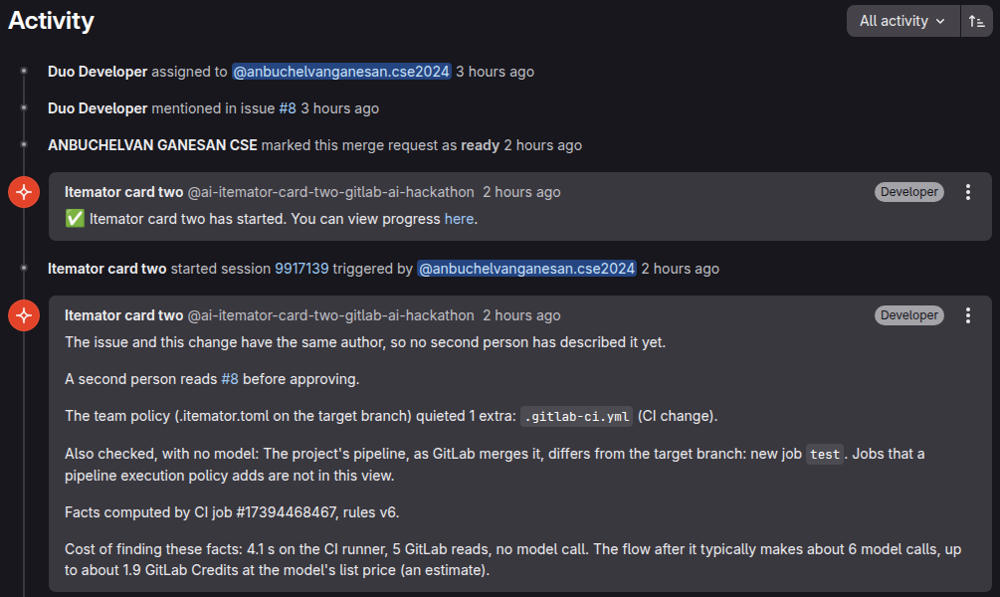
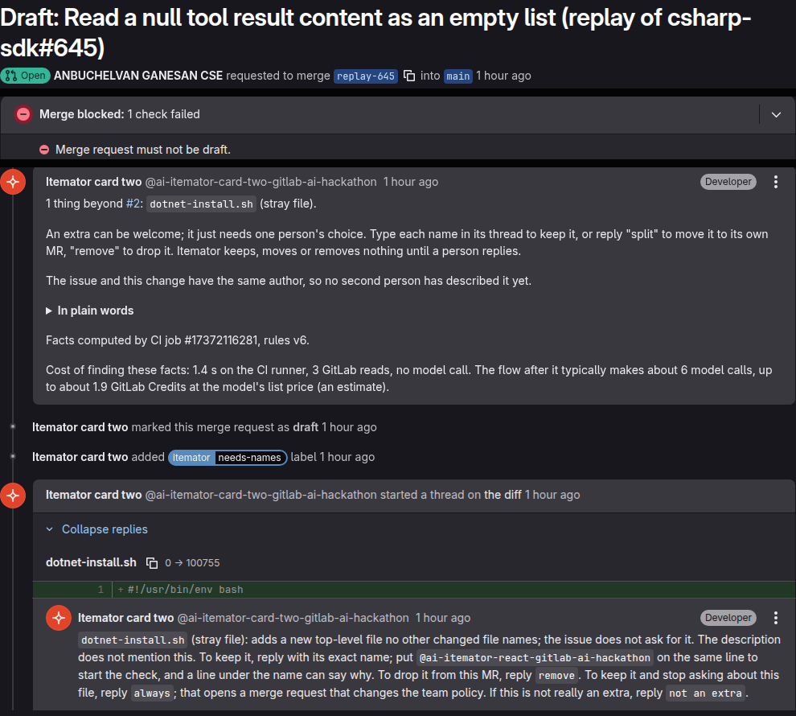
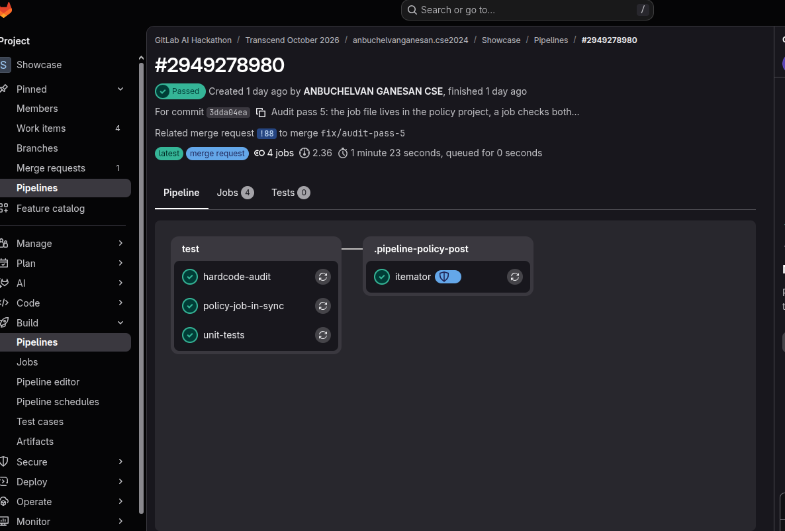
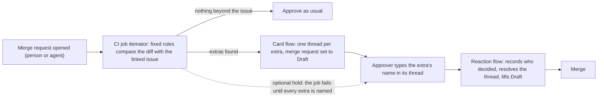

# Itemator

**Itemator holds a coding agent's merge request as a draft until a person answers for each file its issue never asked for, such as a new dependency or a stray install script.**

It is a CI job and two GitLab Duo flows. We call those files extras.

*A real agent merge request (!7): the card asks, the author types `always`, and the next one (!9) asks nothing.*

Coding agents slip in files nobody asked for. Asked to fix one bug in the Model Context Protocol's C# SDK, GitHub Copilot also committed `dotnet-install.sh`, an install script, and a maintainer had to spot it and write "this file looks unnecessary, please delete it" ([the comment](https://github.com/modelcontextprotocol/csharp-sdk/pull/645#discussion_r2225905461)). Itemator asks about a file like that when the pipeline finishes, before anyone has to spot it. A hurried patch is when it happens most easily: in the week PHP and GitLab shipped emergency security fixes, teams pushed patch merge requests out fast, many written by agents ([patch week](#patch-week-phps-and-gitlabs-own-advisories)).

*Life After Code, Path A, Assisted: a person answers each extra and approves every merge; the flows only ask and act on the answers. [MIT licence](LICENSE).* For teams that let coding agents open merge requests:

1. A CI job lists the extras with fixed rules, no model.
2. A GitLab Duo flow posts one thread per extra and sets the merge request to draft.
3. You answer in the thread: the extra's name keeps it, `split` or `remove` moves it out. Draft lifts when every extra has an answer, and a person still approves the merge request.

The list can come from anywhere: these rules, a model's second look, or another checker you plug in. What Itemator adds is the decision: each file gets a named person's typed answer, kept on the merge request and reused as policy.

It asks less as your team answers: type `always` in a thread and the flow opens a one-line policy merge request; once a person merges it, Itemator stops asking about that file. On !9, the next agent merge request after a person answered `always` once, the card asked nothing ([how often that would save a question](docs/measurements.md#how-often-the-same-question-comes-back)).

**Live, not staged:** [!7](https://gitlab.com/gitlab-ai-hackathon/transcend-october-2026/39194174/second-project/-/merge_requests/7#note_4070852403) asked once → the author typed `always` → the policy change [!8](https://gitlab.com/gitlab-ai-hackathon/transcend-october-2026/39194174/second-project/-/merge_requests/8) was merged on the owner's account, by their coding assistant through the API as the test planned → the next agent merge request, [!9](https://gitlab.com/gitlab-ai-hackathon/transcend-october-2026/39194174/second-project/-/merge_requests/9#note_4070902521), asked nothing.

GitLab's Developer Flow opened !7 and !9; we undid the policy afterwards (!10) to test again. GitLab loads threads with JavaScript; without it, read [!7's threads](https://gitlab.com/gitlab-ai-hackathon/transcend-october-2026/39194174/second-project/-/merge_requests/7/discussions.json) or [!9's](https://gitlab.com/gitlab-ai-hackathon/transcend-october-2026/39194174/second-project/-/merge_requests/9/discussions.json) as plain data, or see the screenshots.

[Every step, with its times and faults](docs/measurements.md#an-always-answer-stops-the-next-question). GitLab lists the person who started the flow as the author, and the `duo/` branch is the flow's.

*Staged, labelled as such: the card on a replay of the example below.*

**That example, replayed.** Itemator's rules list `dotnet-install.sh` on their own; the version used here was frozen on 12 October ([commit](https://gitlab.com/gitlab-ai-hackathon/transcend-october-2026/39194174/showcase/-/commit/441e680)), before we read any reviewer comment. On public agent pull requests the same rules list 24 <!-- from: results/real_catches_v1.json:summary.pairs --> files that a reviewer had commented on, this one included ([each one, with the reviewer's words](results/real_catches.md)). A wrong question costs one reply, `not an extra`; how often each happens is on [the measurements page](docs/measurements.md#what-we-measured).

**Try it in three clicks, no login.**
1. [Paste a diff and its issue](https://showcase-3cd72e.gitlab.io/try/), or click an example: the page lists each package the issue does not name, as the CI job would, and runs three supply-chain checks too. Nothing you paste leaves it.
2. [The real example, start to finish](https://gitlab.com/gitlab-ai-hackathon/transcend-october-2026/39194174/second-project/-/merge_requests/2#note_4065417055). On a staged replay of #645 the card names `dotnet-install.sh`, the author answers `remove`, the flow [takes the file out](https://gitlab.com/gitlab-ai-hackathon/transcend-october-2026/39194174/second-project/-/commit/c6e77871f9abc25c80250d87616a7790d4d5be4b) and [says every extra has an answer](https://gitlab.com/gitlab-ai-hackathon/transcend-october-2026/39194174/second-project/-/merge_requests/2#note_4066468298). We re-created the change; the job and both flows ran on it for real on October 22, with [two known faults, left on its page](docs/measurements.md#the-real-example-run).
3. [What shipped](https://showcase-3cd72e.gitlab.io/): each merge to main, its extras, and who named each.

The card also lists a model's second look, files the issue may not need that the rules missed; it never holds the merge request ([live on !13](https://gitlab.com/gitlab-ai-hackathon/transcend-october-2026/39194174/second-project/-/merge_requests/13#note_4072709312)).

**What it needs.**
- GitLab Premium or Ultimate with the Duo Agent Platform, for the two flows.
- A public project, for now: GitLab's job token cannot read issues, so in a private project the rules would have no issue to compare with. We have not run it in a private project ([limits](docs/limits.md)).
- The project setting "All threads must be resolved". Without it an unanswered extra still marks the merge request as draft, but the merge button stays on.
- Optional, Ultimate only: a policy that runs the check from outside the project, so a merge request cannot edit it. Linking the policy takes an Owner once.
- Nothing extra for coding agents' merge requests. On an agent's draft, the card starts when a person marks it ready, a step GitLab already requires before a draft can merge ([timed on !7](docs/measurements.md#the-card-starts-when-a-person-marks-the-agents-draft-ready)).
  - GitLab's own triggers cannot start it earlier: GitLab starts no flow from a bot's pipeline or when an agent opens a merge request ([GitLab's docs](https://docs.gitlab.com/user/duo_agent_platform/triggers/), [we tried both](docs/measurements.md#a-merge-request-gitlabs-developer-flow-opened-issue-to-merge)).
  - An optional CI job starts it on the agent's own pipeline instead, with a person's token ([setup](docs/setup.md#3b-agent-merge-requests-optional-start-the-card-without-a-person); live on [!14](https://gitlab.com/gitlab-ai-hackathon/transcend-october-2026/39194174/second-project/-/merge_requests/14#note_4074293763), session finished in 96 <!-- from: results/autostart_live_v1.json:session.seconds --> s, nobody marked it ready, [record](results/autostart_live_v1.json)).

It runs on this public project, and on [a second one](https://gitlab.com/gitlab-ai-hackathon/transcend-october-2026/39194174/second-project) without the policy. [Setup](docs/setup.md): one command writes your copies of the flows and the job.

**Answers from outside the project.** Every other answer here came from the owner's accounts.

- On !278 a person who had not seen the project made a GitLab account, kept the extra and said why in their own words ([their reply](https://gitlab.com/gitlab-ai-hackathon/transcend-october-2026/39194174/showcase/-/merge_requests/278#note_4055666063), [the note on the issue](https://gitlab.com/gitlab-ai-hackathon/transcend-october-2026/39194174/showcase/-/issues/81), [record](results/outside_answer_live.json); rules written first: [eval/outside_answer_rubric.json](eval/outside_answer_rubric.json)).
- A with/without test from the hackathon's Discord, registered before we asked anyone, is still open: the first reviewer, with Itemator, asked to remove the planted package; the second, without it and asked directly rather than through Discord, replied "i dont know". Two people reached in different ways show nothing yet, and we claim no difference ([so far](docs/measurements.md#reviewers-from-outside-the-project-still-open)).

### In numbers

| Question | Answer |
|---|---|
| How long did those reviewers take to comment on the file? | A median of 3 <!-- from: results/catch_delay_v1.json:summary.median_whole_hours --> hours after it appeared; the 8 <!-- from: results/catch_delay_v1.json:summary.by_outcome.landed_with_the_file.n --> files that landed anyway were spotted a median of 24 <!-- from: results/catch_delay_v1.json:summary.by_outcome.landed_with_the_file.median_whole_hours --> hours in. The card asks when the pipeline finishes ([timing](docs/measurements.md#how-long-a-person-took-to-spot-it)) |
| Does it stay quiet when there is nothing to ask? | On merge requests GitLab's own Duo Developer Flow merged into gitlab-org/gitlab in September 2026, it spoke on 9 <!-- from: results/public_replay_a1.json:G.agent.flagged --> of 84 <!-- from: results/public_replay_a1.json:G.agent.scored --> and stayed silent on the rest; on merge requests people wrote there, 6 <!-- from: results/public_replay_a1.json:H.merged.flagged --> of 113 <!-- from: results/public_replay_a1.json:H.merged.scored -->. Two model labellers found a clear extra in none of the agent ones it spoke on (0 <!-- from: results/public_replay_labels.json:per_merge_request.G_flagged.strict -->): most deleted tests along with the feature flag they cover, as GitLab's docs ask, so each cost one typed reply. ([replay](results/public_replay_a1.json), [more](docs/background.md)) |
| What does a merge request cost? | The check job makes no model call; the card flow makes about 6 <!-- from: results/cost_per_run.json:card_run_model_calls.typical --> ([cost](results/cost_per_run.json)) |
| When an agent moves a runtime or image version, does it leave copies on the old one? | On public agent pull requests, 9 <!-- from: results/leftbehind_study_v1.json:summary.left_behind.prs --> of 24 <!-- from: results/leftbehind_study_v1.json:summary.with_a_move_read --> did; no reviewer named any ([study](docs/measurements.md#do-agents-leave-copies-on-the-old-version)) |
| Does a new dependency's thread name known malware? | On 200 <!-- from: results/malware_replay_v1.json:summary.sampled --> real PyPI names OpenSSF reports, all 200 <!-- from: results/malware_replay_v1.json:summary.named_report -->, including the 198 <!-- from: results/malware_replay_v1.json:summary.gone_from_pypi --> PyPI has taken down ([replay](docs/measurements.md#does-the-thread-name-known-malware)) |

Every other number, with what it does not show, the real runs and each check the card can add: [docs/measurements.md](docs/measurements.md#the-front-pages-numbers-in-full).

**What it names.** A new dependency, a CI or config file, deleted or weakened tests, a removed public function, a binary file, a git hook, and a file that instructs coding agents. An issue can list what a change may touch (an `itemator-scope` block); then anything outside it is an extra. When the issue names a CVE, the version change is the fix and every other file is asked about ([how](docs/how-it-works.md#patch-day); staged run on [!17](https://gitlab.com/gitlab-ai-hackathon/transcend-october-2026/39194174/second-project/-/merge_requests/17#note_4080637136)). When a change moves PHP, or any runtime or image, to a new version in one file, each other file that still runs the old version gets a thread too, such as the CI test image or a staging compose file, and `bump` moves it ([how](docs/how-it-works.md#left-behind)). On public agent pull requests that moved a version, 9 <!-- from: results/leftbehind_study_v1.json:summary.left_behind.prs --> of 24 <!-- from: results/leftbehind_study_v1.json:summary.with_a_move_read --> left another file on the old one; we read 5 <!-- from: results/leftbehind_study_v1_labels.json:counts.real --> of those as real, and no reviewer named any ([study](docs/measurements.md#do-agents-leave-copies-on-the-old-version)). An extra kept as a stopgap can be answered `until #N`: the merge request that later closes #N asks whether to take the stopgap out, as long as it is still in the code ([how](docs/how-it-works.md#stopgaps)). The card also states facts that ask nothing, such as shapes seen in supply-chain attacks ([every check](docs/measurements.md#at-a-glance-every-check-in-one-table)).

Compared with a check that fails the pipeline, and the policy job

**Compared with a check that fails the pipeline.** Such a check decides for everyone, and its reason is a log line. Itemator leaves each extra to a person and keeps that person's answer and reason in [a public log](https://showcase-3cd72e.gitlab.io/answers/), where the next merge request that adds the same file finds it. Each card also says what finding the facts cost.

**What it looks like.** The card is the picture near the top (fixed two lines, then one thread on the changed line). Here, a pipeline where the `itemator` job comes from a policy, not from the project's own CI file (the shield badge).

**Entered for Most Environmentally Impactful.** Each new dependency's thread says what it downloads on every fresh install, so a reviewer can say no before the bytes ship; and the check's own job moved to a much smaller image, which cut its own footprint per run. How both were measured, and what they do not show: [docs/background.md](docs/background.md) and [docs/measurements.md](docs/measurements.md).

## Patch week: PHP's and GitLab's own advisories

In October two unrelated emergencies overlapped. On 21 October PHP shipped 8.3.36 and its sibling releases for two flaws in the PHP engine that let an unauthenticated request run code (CVE-2026-109618 and CVE-2026-109619); PHP's advisory says an exploit had been demonstrated ([php.net](https://www.php.net/archive/2026.php#2026-10-21-5)). GitLab patched self-managed instances for two flaws that let anyone run code on the server: one through a CI configuration on 12 October (CVE-2026-97229, [19.4.2](https://docs.gitlab.com/releases/patches/patch-release-gitlab-19-4-2-released/)) and one on 21 October (CVE-2026-110264, [19.5.1](https://docs.gitlab.com/releases/patches/patch-release-gitlab-19-5-1-released/)). GitLab.com was already patched, and GitLab was not attacked through PHP.

A week like that is when merge requests are written in a hurry, often by an agent, and reviewed in a hurry. Itemator does not decide whether a version is safe; it makes sure a person answers for everything around the fix:

- **The fix and nothing else.** When the issue names a CVE, the version change is taken as the fix and every other file gets a thread. Staged on [!17](https://gitlab.com/gitlab-ai-hackathon/transcend-october-2026/39194174/second-project/-/merge_requests/17): a PHP 8.3.36 bump that also added a script that downloads and runs code; the card asked about the script only, and the owner's `remove` took it out.
- **Copies left behind.** The Dockerfile moves to PHP 8.3.36 while a staging compose file still runs 8.3.35, so production is patched and staging is not. The card names that file, and `bump` moves it in one commit ([!20](https://gitlab.com/gitlab-ai-hackathon/transcend-october-2026/39194174/second-project/-/merge_requests/20), staged). On public agent pull requests that moved a version, 9 <!-- from: results/leftbehind_study_v1.json:summary.left_behind.prs --> of 24 <!-- from: results/leftbehind_study_v1.json:summary.with_a_move_read --> left another file on the old one, and no reviewer named any ([study](docs/measurements.md#do-agents-leave-copies-on-the-old-version)). In this week's real PHP fixes, 2 <!-- from: results/php_patch_study_v1.json:summary.left_behind.prs --> of 32 <!-- from: results/php_patch_study_v1.json:summary.with_a_move_read --> did the same: one, merged as "critical PHP RCE fixes", still builds a second image from the unfixed PHP today ([study](docs/measurements.md#in-the-week-of-phps-advisory-did-fixes-leave-a-copy-behind)).
- **A stopgap that ends with its fix.** A workaround kept while the patch is pending can be answered `until #N`; the merge request that later closes #N asks whether to take it out ([!21](https://gitlab.com/gitlab-ai-hackathon/transcend-october-2026/39194174/second-project/-/merge_requests/21) kept a package until #13; [!22](https://gitlab.com/gitlab-ai-hackathon/transcend-october-2026/39194174/second-project/-/merge_requests/22), the fix, asked, and `taken out` was checked; staged).
- **Answers nobody outside can fake.** On a public project anyone can comment; only a project member with the Developer role or higher can answer, and a CI file the team quieted is asked about again when the change pipes a download into a shell (!25, staged; the question is in [its CI job log](https://gitlab.com/gitlab-ai-hackathon/transcend-october-2026/39194174/second-project/-/jobs/17436584049), as the card did not run there).
- **Not feeding the flaw.** The CI job asks GitLab's CI lint for the pipeline a change produces. On a GitLab version these advisories list, the job does not send the change's CI file to that endpoint, and the card says why ([limits](docs/limits.md)).
- **Known malware by name.** A hurried fix that adds a package gets a thread with registry facts; when OSV has a malware report for the package, the thread says so first, even after the registry has taken the package down. On 200 <!-- from: results/malware_replay_v1.json:summary.sampled --> real reported PyPI names it named the report every time, 200 <!-- from: results/malware_replay_v1.json:summary.named_report -->; before, it said only "not found" ([replay](docs/measurements.md#does-the-thread-name-known-malware)).

The code itself has a second home that week. Every update to this repo is also copied, as one commit, to [GitHub](https://github.com/Anbu-00001/Itemator), naming the GitLab commit it copies, so it stays readable while a self-managed GitLab is offline for its patch; `python3 tools/check_mirror.py` compares the two copies file for file and would show a copy changed on either host.

Every staged merge request above was made by hand on the owner's accounts for the demo, and is labelled as such.

## How it works

1. **A CI job lists the extras.** The `itemator` job reads the merge request's diff and its linked issue and applies fixed rules (`itemator/extras.py`): a new dependency, a CI or config change, removed tests, a removed public function, deleted generated code, a committed binary, large file or build output, a version bump, a stray file. No model decides whether an extra exists. It writes `itemator.json`.
2. **A GitLab Duo flow posts the card** (`flows/itemator_card.yml`): two lines, what is beyond the issue and what the approver does next, then one resolvable thread per extra on the line it changed. It sets the merge request to Draft.
   - **When it starts:** when the pipeline of a merge request a person opened finishes. GitLab starts no flow for a merge request an agent opened, because every trigger needs a human to act ([its trigger documentation](https://docs.gitlab.com/user/duo_agent_platform/triggers/)). On an agent's draft the card starts when a person marks it ready ([a live run](docs/measurements.md#the-card-starts-when-a-person-marks-the-agents-draft-ready)), or, with an optional CI job, on the agent's own pipeline ([setup](docs/setup.md#3b-agent-merge-requests-optional-start-the-card-without-a-person), live on [!14](https://gitlab.com/gitlab-ai-hackathon/transcend-october-2026/39194174/second-project/-/merge_requests/14#note_4074293763)).
   - **A wide merge request:** when the extras name more than ten files in two or more threads, the card asks one question instead: split the merge request, or type `all-N-files` in its one thread to keep them all ([why ten, untested until 25 October](docs/measurements.md#one-question-for-a-wide-merge-request)).
   - **What the model adds:** one sentence per thread on what the file does, so the approver can answer without opening it. The fixed rules decide what is an extra; the model only describes it, and the thread says the sentence is the model's reading to check ([a staged check](https://gitlab.com/gitlab-ai-hackathon/transcend-october-2026/39194174/showcase/-/merge_requests/313): it described an install script and flagged a note written to sway automated reviewers without repeating it).
3. **The approver answers in the thread** with one word each: the extra's exact name keeps it, `not an extra` dismisses it, `split` moves a CI or config file or a package manifest into its own merge request, `remove` takes it back out of this one (like `split`, only for whole CI or config files, or a manifest whose only change is the named package; `remove` also takes back a file the merge request adds). The thread offers only the answers the flow accepts for that extra.
   - **When it reads them:** `flows/itemator_react.yml` reads the answers when someone mentions its account or marks the merge request ready.
   - **Several at once:** One reply to the card can keep several extras, one exact name per line ([live check](https://gitlab.com/gitlab-ai-hackathon/transcend-october-2026/39194174/second-project/-/merge_requests/5#note_4067447111), [record](results/several_live_v1.json)); `split`, `remove` and `not an extra` stay in each extra's thread.
   - **Plain words:** A reply in plain words gets one "Read as" line naming the word the flow thinks was meant, and nothing changes until that word is typed ([live check](https://gitlab.com/gitlab-ai-hackathon/transcend-october-2026/39194174/second-project/-/merge_requests/5#note_4067255459), [record](results/read_as_live_v1.json)).
   - **What it records:** It records who typed what, reopens a thread that was resolved without a name, and takes Draft off when every extra is settled. Its summary lists each extra with who decided, and says so when the author typed every answer. It also leaves a note on the issue the merge request closes, listing each extra and who decided it, so the plan records what was done beyond it ([issue #79](https://gitlab.com/gitlab-ai-hackathon/transcend-october-2026/39194174/showcase/-/issues/79), from the live run of 2026-10-20; also [#75](https://gitlab.com/gitlab-ai-hackathon/transcend-october-2026/39194174/showcase/-/issues/75) and [#55](https://gitlab.com/gitlab-ai-hackathon/transcend-october-2026/39194174/showcase/-/issues/55)).
   - **In this project:** Here the card also starts by itself when the pipeline finishes, and `split` moved a file to its own merge request on [!10](https://gitlab.com/gitlab-ai-hackathon/transcend-october-2026/39194174/showcase/-/merge_requests/10#note_3993186796) ([record](results/mr10_transcript.json)).

Another checker's findings can use the same threads

Set `ITEMATOR_OTHER_CHECKER` ([setup](docs/setup.md)). Itemator's own rules ask only about kinds of change that need a person's choice, so on the 587 <!-- from: results/combined_v1.json:cases --> files reviewers objected to they name 27 <!-- from: results/combined_v1.json:named.itemator -->, fewer than two free checkers that also flag ordinary code files. Their findings can open the same threads: with Overreach's, 75 <!-- from: results/combined_v1.json:named.itemator_with_overreach --> of those files get a question ([measurements](docs/measurements.md)).

What was decided before comes along, in this project or another

If someone already answered an extra with the same name, in this project or in another one whose public answer log it reads, the thread says who decided what, where and when, read from the public answer log only when its hash chain holds; when earlier answers disagree, it names those merge requests too. In a second project the thread for a stray file said showcase had removed it, and that an earlier answer there kept it ([thread](https://gitlab.com/gitlab-ai-hackathon/transcend-october-2026/39194174/second-project/-/merge_requests/1#note_4065276875)). A person there still types the answer; we typed `remove`, and that project's own reaction flow took the file out and lifted Draft ([summary](https://gitlab.com/gitlab-ai-hackathon/transcend-october-2026/39194174/second-project/-/merge_requests/1#note_4065942500)). The skill for coding agents tells them to read that log before writing; a pre-registered test of whether that changes what an agent writes could not tell, because in forty runs the agent added no extra at all, with the log or without it ([results](docs/measurements.md#does-a-coding-agent-read-the-answer-log)).

It covers three moments: while an agent writes the change (a skill tells it to stay inside the issue and to say what it could not avoid), when a person reviews it (the card and one thread per extra), and after the merge (a note on the issue and a page of what shipped, with who decided).

On your own machine, with no GitLab and no model: `python -m itemator.local --issue issue.txt`, or `python -m itemator.local --commits --map` for an agent's local commits.

The remaining steps (registry facts, the description sentence, `always`, the optional hold, the asker rule, the decision log, the skills) and the live runs are in [docs/how-it-works.md](docs/how-it-works.md); the measurements and their limits are in [docs/measurements.md](docs/measurements.md). To install it in your own project, see [docs/setup.md](docs/setup.md).

## Background

The first run, the design choices, why now, and the related tools (some already compare a change with its issue or a declared scope): [docs/background.md](docs/background.md).

## Which lifecycle stages it touches
We count a stage only where Itemator reads or writes something in it:

| Stage | What Itemator does there | Open it |
|---|---|---|
| Plan | Reads the linked issue and checks the change against what it says | [the issue a card read](https://gitlab.com/gitlab-ai-hackathon/transcend-october-2026/39194174/showcase/-/issues/39) |
| Create | Reviews the merge request, opens one thread per extra, moves or removes an extra | [a merge request with its card, thread and summary](https://gitlab.com/gitlab-ai-hackathon/transcend-october-2026/39194174/showcase/-/merge_requests/45) |
| Verify | Runs as a CI job on every merge request pipeline; starts a Duo flow when it finishes. The same job also writes the extras as GitLab Code Quality findings (severity info, on each thread's line) and a Metrics report (`itemator/glreports.py`) | [pipelines](https://gitlab.com/gitlab-ai-hackathon/transcend-october-2026/39194174/showcase/-/pipelines), [the job's log](https://gitlab.com/gitlab-ai-hackathon/transcend-october-2026/39194174/showcase/-/jobs/17265337254) |
| Package | Looks up new dependencies on their public registries (PyPI, npm, crates.io, the Go module proxy; NuGet for packages added in .NET project files, shown beside the extras); a deployment job also uploads the checker to this project's package registry | [package registry](https://gitlab.com/gitlab-ai-hackathon/transcend-october-2026/39194174/showcase/-/packages) |
| Secure | Shows advisories and licences for new dependencies; flags committed binaries and build output; GitLab's secret detection and SAST templates run on every merge request pipeline; the card's own checks name lines of shapes that have carried attacks and strangers' text run in CI (on 31 <!-- from: results/advisory_holdout_v2.json:cases --> published advisories set aside before the rule was written, its first version named 10 <!-- from: results/advisory_holdout_v1.json:caught --> and its second version, written after we knew that result, 15 <!-- from: results/advisory_holdout_v2.json:caught -->) | [held-out advisory replay](results/advisory_holdout_v2.json), [SAST job](https://gitlab.com/gitlab-ai-hackathon/transcend-october-2026/39194174/showcase/-/jobs/17266699652) |
| Configure | Reads a team policy from the target branch; the flows and skills are set up per project; the deploy job runs in a `resource_group` (two merges deploy one after the other) and reads a variable scoped to the `production` environment | [team policy file](.itemator.toml), [deploy log](https://gitlab.com/gitlab-ai-hackathon/transcend-october-2026/39194174/showcase/-/jobs/17266699659) |
| Govern | Records who decided each extra; the policy can require a second person. The check itself is injected by a pipeline execution policy, so a merge request cannot edit or skip it (a push straight to the default branch still can; see [Known limits](#known-limits)): 0 <!-- from: results/bypass_matrix_v2.json:merged --> of 11 <!-- from: results/bypass_matrix_v2.json:attempts --> bypass attempts merged; 9 <!-- from: results/bypass_matrix_v2.json:blocked_by_the_itemator_job --> failed the check itself (in three of those the unit tests failed too, so those three would have been stopped anyway) and the other two were stopped by GitLab refusing a second job with the same name | [bypass attempts](results/bypass_matrix_v2.json), ["triggered by policy" in a job log](https://gitlab.com/gitlab-ai-hackathon/transcend-october-2026/39194174/showcase/-/jobs/17265337254) |
| Release | Every push to the default branch records a deployment of a `production` environment, uploads the checker as a package version, and publishes a page of what shipped in it (only merge requests are listed; a commit pushed straight to the branch has none): the merge requests, their extras and who named each ([live page](https://showcase-3cd72e.gitlab.io/), written by `itemator/shipped.py` from GitLab's own deployment records); the same push rebuilds [the answer log](https://showcase-3cd72e.gitlab.io/answers/) (`itemator/answerlog.py`): every recorded answer, each entry carrying the SHA-256 of the one before, built on the copy the site published last, so a later edit or deletion shows; on a tag, the `decision-log` job writes the same kind of section into that release's description | [release with its decisions](https://gitlab.com/gitlab-ai-hackathon/transcend-october-2026/39194174/showcase/-/releases/v0.1.0-rc1), [live page](https://showcase-3cd72e.gitlab.io/) |
| Monitor | The same job, run by hand for any window, reports how extras were decided (kept, dismissed, moved, removed) and how many names the merge request's own author typed alone. It watches the review process, not a running service. The `scan-history` job runs the same rules over merge requests already merged. After each page publish on the default branch, the `pages-smoke-check` job fetches the published pages and fails if one does not answer | [scan-history run](https://gitlab.com/gitlab-ai-hackathon/transcend-october-2026/39194174/showcase/-/jobs/17231250573), [pages check](https://gitlab.com/gitlab-ai-hackathon/transcend-october-2026/39194174/showcase/-/jobs/17266699661) |

That touches each of the nine stages the organisers list, and we claim no more than the table says. Monitor is the thinnest: one read-only report and a check that the published pages answer. Release is a package upload, a deployment record and a generated page, added on 2026-10-15. After each deployment one job checks that the published pages answer; nothing watches them continuously.

## Known limits
- **The flow triggers are switched off outside our own runs.** Each run uses Duo usage, which GitLab bills to the top-level group, so a visitor who opens a merge request here will not see a card; the video and the results files show full runs. They stay off after the submission deadline until the winners are announced, as the hackathon's rules ask.
- **The forward test is not read yet.** On 2026-10-21 we sealed 60 <!-- from: results/prospective_v1_sealed.json:summary.pull_requests --> agent pull requests that were open on GitHub, with the 245 <!-- from: results/prospective_v1_sealed.json:summary.listed_files --> files the frozen rules list in them ([results/prospective_v1_sealed.json](results/prospective_v1_sealed.json); the list's SHA-256 is `1281919d8262256d45363f315cc74afe4e54023a4d1e855fba59dc150ed38647`). It asks the question past data answered against us: on agent pull requests with reviewer comments, files the rules listed drew an objection less often than files they did not (24 <!-- from: results/aidev_lift_v6.json:summary.main.listed.objected --> of 2,023 <!-- from: results/aidev_lift_v6.json:summary.main.listed.files --> against 479 <!-- from: results/aidev_lift_v6.json:summary.main.unlisted.objected --> of 12,078 <!-- from: results/aidev_lift_v6.json:summary.main.unlisted.files -->; two pull requests hold about half the listed files, [results/aidev_lift_v6.json](results/aidev_lift_v6.json)). Leaving those mass changes out, on pull requests with one to ten listed files, a listed file drew an objection in 19 <!-- from: results/aidev_lift_v6.json:summary.exploratory_not_registered.pull_requests_with_1_to_10_listed_files.listed.objected --> of 200 <!-- from: results/aidev_lift_v6.json:summary.exploratory_not_registered.pull_requests_with_1_to_10_listed_files.listed.files --> cases and an unlisted file in 78 <!-- from: results/aidev_lift_v6.json:summary.exploratory_not_registered.pull_requests_with_1_to_10_listed_files.unlisted.objected --> of 4,245 <!-- from: results/aidev_lift_v6.json:summary.exploratory_not_registered.pull_requests_with_1_to_10_listed_files.unlisted.files -->. We chose that cut after seeing the first result, so it is a hypothesis, not a finding; it was added to the forward test before any of its outcomes existed. On 2026-10-25 a script reads whether a reviewer objected to those files, whether they left the pull request, or whether they merged with no objection ([eval/prospective_rubric.json](eval/prospective_rubric.json)). The sentence for every possible result, a bad one included, is already committed ([eval/prospective_sentences.json](eval/prospective_sentences.json)): the script picks one by a fixed rule, fills in the counts and puts it here word for word, so the listed files count as ahead only if reviewers acted on a larger share of them than of the files the rules did not list. Until then we have no forward result.
- **Rules miss things.** For example, a one-line edit of a dependency list in `pyproject.toml` was missed until a live test found it (fixed in rules v4). The audits list more.
- **Only project members can answer, and only from now on.** A name or `not an extra` counts only from a project member with the Developer role or higher, which is GitLab's own bar for approvals (the pipeline checks the role; the reaction flow can only see that the person is a member); `split` and `remove` also need the author, an assignee or a reviewer. The reply on !278 below came from someone outside the project, before this rule; such a reviewer now has to be added to the project first ([how](docs/how-it-works.md)).
- **A model follows the reaction steps.** Code decides which extras exist; the Duo model checks replies with the fixed string tests in `flows/itemator_react.yml`. It passed our live tests. Where a project holds merges until every extra has an answer, the `itemator` job runs the same tests as code before it lets the merge through, so a thread resolved by hand, or a reply the model misread, keeps the hold on ([tests](tests/test_hold.py)). If the job's token cannot read the threads, the summary alone lifts the hold, as before, and the job's report says the check was skipped; we have not seen which way GitLab's job token goes here. The same tests now also run as code on every live thread afterwards ([itemator/replycheck.py](itemator/replycheck.py)): all 55 <!-- from: results/react_audit_v1.json:count.agree --> answers the flow has recorded here and in the second project match them, with the same person, and 0 <!-- from: results/react_audit_v1.json:count.differ --> differ ([results](docs/measurements.md#the-reaction-flows-answers-checked-by-code)); most of those replies are ours. We also wrote eight replies down first ([eval/react_study_cases.json](eval/react_study_cases.json): an exact name, a name in backticks with a full stop after a wrong reply, a dismissal, `remove`, a name in upper case, another thread's name, an instruction aimed at the flow, a name typed with the mention) and ran them once on a throwaway merge request: the flow ended as expected on 8 <!-- from: results/react_study.json:as_expected --> of 8 <!-- from: results/react_study.json:cases -->, including the three that had to stay open. A first list of thirteen, which also held a question and "keep it", was replaced before any run because the rules put stray files in one thread; a second round on a newer version of the flow put those two cases back and ended as expected on 8 <!-- from: results/react_study_round2.json:as_expected --> of 8 <!-- from: results/react_study_round2.json:cases -->. That is one run of one model on cases we wrote, so it is not a misread rate ([results/react_study.json](results/react_study.json)).
- **Typing is not reading.** We have not measured whether typing a name changes what approvers do. What it changes for certain is the record: each extra says who kept it. We have not measured how many real problems the rules miss; the table's row on what human reviewers called out of scope counts one kind of miss, and is not a recall figure.

The others, among them the policy and lock settings, the untested approved event and the narrow `split` and `remove`: [docs/limits.md](docs/limits.md).

## Where things are

The repository, folder by folder

| Folder | What is in it |
|---|---|
| `itemator/` | The checker: the rules, the CI job, the package facts and weights, the decision log and the generated pages |
| `ci/` | The job file the pipeline execution policy injects into every merge request pipeline |
| `flows/` | The two GitLab Duo custom flows: the card and the reaction |
| `skills/` | Two Agent Skills: one for an agent writing a change, one for answering a card |
| `web/` | The pages on GitLab Pages: try a diff, weigh a package, the picture of a change |
| `eval/` | Every study's script, each with the rubric written before it ran |
| `results/` | The output of each study: every number in this README points to one of these files |
| `tests/` | Unit tests, run in every pipeline; the mutation tests run from `eval/mutate_*.py` |
| `tools/` | The hardcode audit, the licence list and a smoke check of the published pages |
| `hf_runner/` | A small runner on a Hugging Face Space that runs the large-dataset studies next to the AIDev dataset |
| `docs/` | Setup, how it works, every measurement with its limits, Google Cloud, and [why the checker stays in Python](docs/why-python.md) |
| `examples/` | A made-up staged change (labelled as such) for the picture of a change, and a sample diff |

## Licence
MIT. See [LICENSE](LICENSE). The evaluation uses the AIDev dataset (CC BY 4.0), fetched by script and not redistributed; see [NOTICE](NOTICE).
