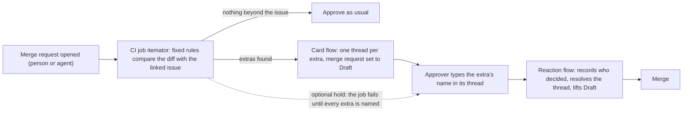

# Itemator

**A CI job lists what a merge request changed beyond its issue; a GitLab Duo flow opens one thread per extra change, and the reviewer types its name to keep it.**

*Life After Code, Path A, Assisted:* the check and the card are automatic; anything beyond the issue is kept, moved or removed only after a person types an answer in its thread, and a person approves the merge request. It never comments line by line: one short card per merge request and one comment for each extra; its only other notes answer a person's reply and sum up at the end.

A CI job compares a merge request with its linked issue and lists the extras: the changes the issue did not ask for, such as a new dependency, a CI or config file, deleted tests, a binary file, or a file that instructs coding agents. A GitLab Duo flow then opens one comment thread per extra and sets the merge request to Draft, which GitLab will not merge. The reviewer answers in the thread: the extra's name keeps it, `split` or `remove` moves it out, and a second Duo flow reads the answer, acts on it and records who decided. The CI job's rules use no AI model.

Why Duo flows and not only CI: a CI job runs when code is pushed and cannot wait for a reviewer's reply; the second flow starts when its account is mentioned on the merge request and then reads what people typed. Changes that stay inside the issue keep one-click approval. GitLab asks contributors for "only one specific issue" per merge request ([contribution criteria](https://docs.gitlab.com/development/contributing/merge_request_workflow/)); Itemator targets that rule and does not enforce it. It works the same on a change a person wrote and one an agent wrote, and it runs on your own machine with no GitLab and no model: `python -m itemator.local --issue issue.txt`, or, for an agent's local commits with no issue, `python -m itemator.local --commits --map`, which also lists every changed file with the reason it was or was not flagged ([how](docs/how-it-works.md)).

**A real example.** In July 2025 GitHub Copilot opened a pull request in the Model Context Protocol's C# SDK to fix one deserialization bug, and also committed `dotnet-install.sh`, an install script the task never mentioned; a maintainer wrote "`@copilot` this file looks unnecessary, please delete it" ([the comment](https://github.com/modelcontextprotocol/csharp-sdk/pull/645#discussion_r2225905461)). The rules, frozen before we read any outcome, list that file on their own. It is one of 24 <!-- from: results/real_catches_v1.json:summary.read --> files in public agent pull requests where a reviewer objected in an inline comment and the rules list the file; [results/real_catches.md](results/real_catches.md) lists every one with the reviewer's words and what the rules say, including the 8 <!-- from: results/real_catches_v1.json:summary.landed_with_the_file --> that landed anyway.

**Check it yourself, no login needed.** One live run, on GitLab as it happened (merge request !249, kept as a record and never merged; its pipeline fails on a licence check because the extra is a BSD-licensed package):
1. [The card](https://gitlab.com/gitlab-ai-hackathon/transcend-october-2026/39194174/showcase/-/merge_requests/249#note_4051994057): one thing beyond the issue, a new dependency.
2. [Its thread](https://gitlab.com/gitlab-ai-hackathon/transcend-october-2026/39194174/showcase/-/merge_requests/249#note_4051994420): what the package brings along, and its weight.
3. [The person's answer](https://gitlab.com/gitlab-ai-hackathon/transcend-october-2026/39194174/showcase/-/merge_requests/249#note_4051997997): the extra's name, and on the next line why it stays. Our test script ([eval/weight_live.py](eval/weight_live.py)) posted it from the project owner's account, so the flow saw a reply from a person; it was not typed by hand.
4. [The flow's reply](https://gitlab.com/gitlab-ai-hackathon/transcend-october-2026/39194174/showcase/-/merge_requests/249#note_4052004427) and [its summary](https://gitlab.com/gitlab-ai-hackathon/transcend-october-2026/39194174/showcase/-/merge_requests/249#note_4052005717): kept, and by whom.
5. [The note on the issue](https://gitlab.com/gitlab-ai-hackathon/transcend-october-2026/39194174/showcase/-/issues/79#note_4052006585): what went beyond the issue, and who decided.

Two more runs, note by note: [results/a_real_run.md](results/a_real_run.md) and, starting from an agent's merge request, [results/a_real_agent_run.md](results/a_real_agent_run.md). The flow triggers are off outside our own runs, so a merge request a visitor opens here gets no card ([why](#known-limits)).

### In numbers

| One merge request | Done by | Model calls | What it costs |
|---|---|---|---|
| Find the extras: a new dependency, a CI or config file, a deleted test, a binary, a file that instructs agents | A CI job, fixed rules | none | seconds on the CI runner |
| Look up each new package and its known advisories (PyPI, npm, crates.io, NuGet, Go) | The same job | none | one or two lookups per package |
| Weigh each new PyPI or npm package: the packages it brings along and their download size, times this project's own pipelines in the last month | The same job | none | one graph read ([deps.dev](https://deps.dev)) and one size read per package |
| Post the card, open one thread per extra, set Draft | The Duo card flow | 6 <!-- from: results/cost_per_run.json:card_run_model_calls.typical --> with three extras (9 <!-- from: results/cost_per_run.json:card_run_model_calls.before_v1_1 --> before we edited its prompt) | up to 1.9 <!-- from: results/cost_per_run.json:card_run_credits.list_price --> GitLab Credits at list price |

| Question | Answer | What it does not show |
|---|---|---|
| Have real reviewers objected to files an AI agent changed that the rules also name? | Yes: 24 <!-- from: results/real_catches_v1.json:summary.pairs --> files in public agent pull requests, named by rules frozen before we read any outcome; 16 <!-- from: results/real_catches_v1.json:summary.did_not_land --> of those files did not land | Not a catch rate: these are the cases where a reviewer wrote an objection we could read ([every case](https://showcase-3cd72e.gitlab.io/catches/)) |
| How often would the card speak on agent pull requests? | On 10,712 <!-- from: results/aidev_population_v6.json:summary.overall.with_an_extra --> of 71,582 <!-- from: results/aidev_population_v6.json:summary.readable --> (about one in seven) | Whether each one was a real extra |
| When it speaks, is it right? | 18 <!-- from: results/precision_audits.json:held_out_pooled.prs_with_real_strict --> of 36 <!-- from: results/precision_audits.json:held_out_pooled.prs_flagged --> flagged pull requests held a clear extra | One model's labels, held-out samples |
| When the rules flag a dependency an agent added beyond its task, what comes with it? | Of a random sample of 300 <!-- from: results/aidev_weight_v1_corrected.json:summary.sampled_lines --> such lines, one per agent pull request, 289 <!-- from: results/aidev_weight_v1_corrected.json:readme.lines_weighed --> could be weighed, 240 <!-- from: results/aidev_weight_v1_corrected.json:readme.weighed_at_latest --> of them at today's latest version because the line pinned none; the median brought 6 <!-- from: results/aidev_weight_v1_corrected.json:readme.median_packages --> packages and 0.57 <!-- from: results/aidev_weight_v1_corrected.json:readme.median_mb --> MB; 117 <!-- from: results/aidev_weight_v1_corrected.json:readme.ten_or_more_packages --> brought 10 <!-- from: results/aidev_weight_v1_corrected.json:readme.threshold_packages --> or more packages and 42 <!-- from: results/aidev_weight_v1_corrected.json:readme.ten_mb_or_more --> weighed 10 <!-- from: results/aidev_weight_v1_corrected.json:readme.threshold_mb --> MB or more ([results/aidev_weight_v1_corrected.json](results/aidev_weight_v1_corrected.json); PyPI sizes re-read after our audit found the wrong wheel choice; the first run is [results/aidev_weight_v1.json](results/aidev_weight_v1.json)) | Today's packages and sizes, not the ones the pull request saw; download size, not energy; nothing says the dependency was wrong to add |
| And how long does that install take on GitLab's runner? | A median of 1.69 <!-- from: results/install_time_pypi_v1.json:readme.median_seconds --> s (PyPI, 38 <!-- from: results/install_time_pypi_v1.json:readme.measured --> lines) and 2.19 <!-- from: results/install_time_npm_v1.json:readme.median_seconds --> s (npm, 40 <!-- from: results/install_time_npm_v1.json:readme.measured --> lines) with no cache; the slowest took 38.05 <!-- from: results/install_time_npm_v1.json:readme.slowest_seconds --> s. Small per run: what stays is the bytes and the packages | One run each on a shared runner; wheels only, no install scripts |
| What did the prompt edit save? | 2.67 <!-- from: results/energy_modelled_v1.json:summary.model_calls_avoided_per_run --> model calls on a three-extras run, modelled at 0.27 <!-- from: results/energy_modelled_v1.json:summary.wh_per_run_avoided_low --> to 80 <!-- from: results/energy_modelled_v1.json:summary.wh_per_run_avoided_high --> Wh | No energy was measured: outside papers differ by about 300 <!-- from: results/energy_modelled_v1.json:wh_per_call.spread --> times, and Duo's model is not disclosed ([results/energy_modelled_v1.json](results/energy_modelled_v1.json)) |
| And in carbon, by the Green Software Foundation's SCI method? | Per fresh CI install, one `remove` of the live run's dependency avoids 0.014 <!-- from: results/sci_estimate_v1.json:readme.live_g_low --> to 2.1 <!-- from: results/sci_estimate_v1.json:readme.live_g_high --> g CO2e (grams of carbon dioxide equivalent), about 13 <!-- from: results/sci_estimate_v1.json:readme.live_month_g_low --> g to 1.9 <!-- from: results/sci_estimate_v1.json:readme.live_month_kg_high --> kg a month at this project's pipelines; for the median dependency, 0.0012 <!-- from: results/sci_estimate_v1.json:readme.median_g_low --> to 0.042 <!-- from: results/sci_estimate_v1.json:readme.median_g_high --> g. The downloads, pipelines and install seconds are ours; every coefficient is borrowed and named in the file ([results/sci_estimate_v1.json](results/sci_estimate_v1.json), [eval/sci_estimate.py](eval/sci_estimate.py)). The thread of each weighed dependency gives the same bracket for that dependency, before anyone answers ([itemator/sci.py](itemator/sci.py), the same code) | A bracket, not a measurement: almost all of the span is the energy per GB of network traffic, which outside papers dispute; a delta in a pipeline's SCI, not a full SCI score |
| Did the prepared facts cut Duo's work? | No. The same card made 16 <!-- from: results/fact_file_ablation_v1.json:summary.total_A --> model calls with the facts and 14 <!-- from: results/fact_file_ablation_v1.json:summary.total_B --> without, on three staged tasks | The facts give checks a model cannot do (package age, opened archives, layout) |

**Measured, not claimed.** In [a real run](results/a_real_run.md) on a change we made for the test, the card put one thread on the CI file its issue never asked for, held the merge until a name was typed, and recorded who typed it. On 31 <!-- from: results/advisory_holdout_v2.json:cases --> published security advisories about CI workflows that we set aside before writing the rule, the first version of one check named 10 <!-- from: results/advisory_holdout_v1.json:caught --> and the second version, written from the first eight cases only (after we knew the first result), named 15 <!-- from: results/advisory_holdout_v2.json:caught --> and stayed quiet on 29 <!-- from: results/advisory_holdout_v2.json:silent_on_fix --> of the fixed versions. Where it does not help: on GitLab's own agent merge requests, reviewers objected to code and tests, which the rules do not list ([Known limits](#known-limits)).

**On a real agent.** We gave GitLab's own Developer Flow the issue "Make the project's checks start faster". It changed only `.gitlab-ci.yml`, a file the issue never names; the change itself, a cache for downloaded packages, is a sensible answer to that issue, and the card does not judge that, it asks a person to confirm the file was meant to change. Itemator opened a thread on that file, the name that kept it was typed (from a script on the project owner's account, so the decision itself was staged; [the run](results/a_real_agent_run.md)), and the flow recorded who kept it.

**What else the card says, with no model and no request needed.** More checks run in the same CI job; each adds one sentence to the card only when it applies: layout-only files, opened archives and binaries, files that never changed together, deleted fences, code added back after a revert, cited commits, reverts and copies that do not match, references that move, a missing change record, lines of a shape that has carried attacks, strangers' text treated as trusted, scanner findings, pipeline changes, new versions and closing words that point at nothing.

Each check, what it reads, and how it was measured

- *Layout-only files.* A modified Python file whose change is only layout, comments, docstrings or the order of plain functions is named as such, because CPython compiles both versions to the same code. It rarely applies: of 102 <!-- from: results/neutral_spike_v1.json:summary.py_files_read --> changed Python files in agent pull requests, it applied to 1 <!-- from: results/neutral_spike_v1.json:summary.py_files_proved -->.
- *Opened files.* An added archive or binary file is opened and described from its own bytes; a `.xz` that unpacks to a script is said to be one. Its description of the type agreed with the `file` tool on 97 <!-- from: results/unwrap_spike_v1.json:summary.by_verdict.agree --> of 100 <!-- from: results/unwrap_spike_v1.json:summary.files_read --> files.
- *Files that never changed together.* A modified file that has never changed in the same commit as any other changed file. Among the files human reviewers commented on in scope comments, 52 <!-- from: results/stranger_spike_v1.json:summary.commented_files_that_are_strangers.k --> of 209 <!-- from: results/stranger_spike_v1.json:summary.commented_files_that_are_strangers.n --> were such files, against 144 <!-- from: results/stranger_spike_v1.json:summary.other_files_that_are_strangers.k --> of 1,480 <!-- from: results/stranger_spike_v1.json:summary.other_files_that_are_strangers.n --> other files; such a file is a fact about the history, not a finding that something is wrong.
- *Deleted fences.* Lines the change deletes outright that a commit whose subject says it fixes something had added (the old SZZ method run backwards, with `git blame`; dotnet/maui's MIT-licensed `find-regression-risk` skill already does a similar mechanical check, matching removed lines against lines added by labelled bug-fix pull requests, so this is not a new idea, only a new place for it). It is a fact from the history, not a finding that the deletion is wrong, and we have no outside measure that it catches a real problem.
- *Added back after a revert.* Lines the change adds that a commit whose subject starts with "Revert" removed from the same file earlier (found with `git log -S`; moved lines, sweeping commits and test or documentation files are left out). The card names the revert, so the reviewer can read why it was made. It is a fact from the history, not a finding that the change is wrong, and we have not yet measured how often it fires on ordinary changes.
- *Cited commits.* A commit id named in a commit message or in the description ("Fixes: <id>", "This reverts commit <id>", "cherry picked from commit <id>", "commit <id>") must be a commit of this project, and a quoted title must be that commit's title. The checkout is asked first and the project's API second, because a CI checkout can be shallow; an id the API cannot answer for is left out, never reported. Agents invent references, and the kernel's tooling checks this only for kernel history. We have not yet measured how often it fires on ordinary changes.
- *Reverts that do not undo.* When the text says "This reverts commit <id>", the lines that commit added must be removed again and the lines it removed put back, file by file. The card names files the change leaves in place (or only half undoes) and files it touches that the reverted commit did not. A text that says "partial" is left alone. The stable-kernel backport check, run on a revert. It is information only. On 1000 <!-- from: results/mesa_noise_v1.json:reverts.sampled --> real Mesa reverts it named something on 160 <!-- from: results/mesa_noise_v1.json:reverts.checks.revert.spoke -->; a language model (not a person) read 25 <!-- from: results/mesa_hit_labels_v1.json:parts.reverts.read --> of those and found 21 <!-- from: results/mesa_hit_labels_v1.json:parts.reverts.right --> that name a real difference; the rest were a file renamed or missing on the other branch, a line that only moved, or unclear.
- *References that move.* Lines the change adds to CI files and Dockerfiles that point at something that moves by design: an image tagged `latest` (or with no tag), an include or component on a branch (`main`, `master`, `HEAD`, `~latest`), a remote include whose URL is a branch, and a download piped into a shell. GitLab's own advice is to pin by digest or commit. A version tag is not named. Only added lines are read. It is information only. It spoke on 0 <!-- from: results/mesa_noise_v1.json:ordinary.checks.moving.spoke --> of 1499 <!-- from: results/mesa_noise_v1.json:ordinary.checks.moving.read --> (of which 4 <!-- from: results/mesa_noise_v1.json:ordinary.checks.moving.readable --> changed a file it reads) ordinary Mesa commits and on 3 <!-- from: results/agent_noise_v1.json:checks.moving.spoke --> of 4451 <!-- from: results/agent_noise_v1.json:checks.moving.read --> (of which 38 <!-- from: results/agent_noise_v1.json:checks.moving.readable --> changed a file it reads) agent-written commits.
- *Change record missing.* Tor, Apache httpd and OpenSSL ask for a short written note with every change a user could notice. Here the project's own history decides whether it has that habit: enough of its last commits that changed shipped files added a file under `changes/`, `changelog.d/`, `newsfragments/` or `.changeset/`, or edited a changelog file. If it does and this change touches shipped files and adds none, the card says so. Tests, documentation, pipeline files, hidden files and the files the layout check proved layout-only do not count, and a text that says no record is needed is respected. A project without the habit gets nothing. It is information only. It stays silent on this project, and on Mesa (which does not have the habit): it spoke on 0 <!-- from: results/mesa_noise_v1.json:ordinary.checks.record.spoke --> of 1499 <!-- from: results/mesa_noise_v1.json:ordinary.checks.record.read --> ordinary Mesa commits. We have not run it on a project that does have the habit.
- *Copies that are not copies.* When the text says "(cherry picked from commit <id>)" or, in the Linux stable style, "commit <id> upstream", the change should add and remove the same lines as that commit. The card names the files and lines of the original that are missing here, and files the change touches that the original did not. The stable-kernel backport check (`check_backports.py` is its nearest tool, GPL, so only the idea is used). Backports often adapt the code, so this is a fact to look at, not a finding. It is information only. On 1000 <!-- from: results/mesa_noise_v1.json:backports.sampled --> real Mesa backports it named something on 57 <!-- from: results/mesa_noise_v1.json:backports.checks.copy.spoke -->; a language model (not a person) read 25 <!-- from: results/mesa_hit_labels_v1.json:parts.backports.read --> of those and found 19 <!-- from: results/mesa_hit_labels_v1.json:parts.backports.right --> that name a real difference; the rest were a file renamed or missing on the other branch, a line that only moved, or unclear.
- *Lines of a shape that has carried attacks.* Lines the change adds, in any file but tests, documentation and lock files, that decode text and run it (`base64 -d | sh`, `eval(atob(...))`), send the whole environment or a credentials file to a server (the Codecov uploader's shape), or download a file and write it over a source file (the Amazon Q extension's shape). Only the named shapes are matched, so an ordinary `curl` or `base64` is not reported. The card gives the file and line. It is a fact about the added text, not a finding that the change is malicious. It spoke on 0 <!-- from: results/mesa_noise_v1.json:ordinary.checks.shapes.spoke --> of 1499 <!-- from: results/mesa_noise_v1.json:ordinary.checks.shapes.read --> ordinary Mesa commits and on 0 <!-- from: results/agent_noise_v1.json:checks.shapes.spoke --> of 4451 <!-- from: results/agent_noise_v1.json:checks.shapes.read --> agent-written commits.
- *Strangers' text treated as trusted.* A merge request title, description, commit message or branch name is written by whoever opens the request. The card names added lines of CI files and shell scripts that hand one of GitLab's variables for such text (`CI_MERGE_REQUEST_TITLE`, `CI_COMMIT_MESSAGE`, `CI_COMMIT_REF_NAME` and the others GitLab's documentation lists) to something that runs it (`eval`, `sh -c`, `python -c`, `node -e`, `jq`, `sed`, `awk`) or to an AI tool's prompt, and GitHub Actions expressions of the same text inside a `run:` line. A variable in double quotes in an ordinary command is not reported, and neither are mapping lines such as `variables:` or `rules:`. It is a fact about the added line, not a finding. It spoke on 0 <!-- from: results/mesa_noise_v1.json:ordinary.checks.untrusted.spoke --> of 1499 <!-- from: results/mesa_noise_v1.json:ordinary.checks.untrusted.read --> (of which 41 <!-- from: results/mesa_noise_v1.json:ordinary.checks.untrusted.readable --> changed a file it reads) ordinary Mesa commits and on 1 <!-- from: results/agent_noise_v1.json:checks.untrusted.spoke --> of 4451 <!-- from: results/agent_noise_v1.json:checks.untrusted.read --> (of which 446 <!-- from: results/agent_noise_v1.json:checks.untrusted.readable --> changed a file it reads) agent-written commits. We also turned eight real, published advisories about workflows round, so that the vulnerable lines looked like added lines: it named the vulnerable line in 5 <!-- from: results/advisory_replay_v1.json:caught --> of 8 <!-- from: results/advisory_replay_v1.json:cases -->, and said nothing about the fixed versions. It missed a composite action file, an expression with a fallback (`a || b`) and a value passed through `env:`. We then ran the check, unchanged, once on more advisories found afterwards by a research agent, the rubric written first: it named the vulnerable line in 10 <!-- from: results/advisory_holdout_v1.json:caught --> of 31 <!-- from: results/advisory_holdout_v1.json:cases --> (workflow files 9 <!-- from: results/advisory_holdout_v1.json:by_kind.W.caught --> of 16 <!-- from: results/advisory_holdout_v1.json:by_kind.W.cases -->, composite action files 1 <!-- from: results/advisory_holdout_v1.json:by_kind.C.caught --> of 12 <!-- from: results/advisory_holdout_v1.json:by_kind.C.cases -->) and said nothing about the fixed version in 30 <!-- from: results/advisory_holdout_v1.json:silent_on_fix --> (in two of those the fix deletes the file, so silence proves little there). The misses are the kinds named above, plus code that builds a shell command. Version 2 of this check (composite action files are read, and the stranger's text may be any term of an expression, as in `a || b`) was written from the first eight only and run once on the same set: it named 15 <!-- from: results/advisory_holdout_v2.json:caught --> of 31 <!-- from: results/advisory_holdout_v2.json:cases --> (composite action files 6 <!-- from: results/advisory_holdout_v2.json:by_kind.C.caught --> of 12 <!-- from: results/advisory_holdout_v2.json:by_kind.C.cases -->) and was silent on 29 <!-- from: results/advisory_holdout_v2.json:silent_on_fix --> of the fixed versions: it now also names a fix that tests a title with `contains(...)`, which gives true or false and is safe. It still speaks on 0 <!-- from: results/untrusted_v2_noise.json:ordinary.checks.untrusted.spoke --> of 1498 <!-- from: results/untrusted_v2_noise.json:ordinary.checks.untrusted.read --> (of which 43 <!-- from: results/untrusted_v2_noise.json:ordinary.checks.untrusted.readable --> changed a file it reads) ordinary Mesa commits and on 1 <!-- from: results/agent_noise_v2.json:checks.untrusted.spoke --> of 4451 <!-- from: results/agent_noise_v2.json:checks.untrusted.read --> (of which 448 <!-- from: results/agent_noise_v2.json:checks.untrusted.readable --> changed a file it reads) agent-written commits.
- *Replay of public incidents.* `eval/incident_replay.py` fetches three public diffs at run time (the Amazon Q extension build script, the Nx pull request that pasted a title into a shell line, and the xz test files) and runs the card's checks on them; the result is `results/incident_replay_v1.json`. All three fire. This is a demonstration, not a measure: the rules were written after reading these diffs. The result file also lists what cannot be replayed and why (the xz build-script half was only in a release tarball, one malicious commit page is gone, and account or registry takeovers never pass through a merge request). The diffs are other people's code and are not stored here.
- *Scanner findings beside the extras (Secure stage).* The project's SAST and secret-detection jobs upload their reports; the Itemator job runs in a later stage of the same pipeline, so GitLab hands it those files. The card joins them to the change: findings on a line the change adds, findings in a file it touches, each marked when the extras list does not name that file. It reads the scanners' output and does not scan; a merge request that edits the scanner job can change what the reports say. It is information only.
- *Pipeline changes.* When a change touches CI files, the card compares GitLab's own merged pipeline configuration (includes, templates and `extends` resolved) at the merge base and at the head, job by job, and names jobs added, removed or changed, including a check turned into a warning (`allow_failure`). Jobs that a pipeline execution policy adds are not in GitLab's view, and the card says so. If GitLab does not allow the read, the card says nothing and the job records a warning.
- *New versions and empty closing words.* A new dependency's thread says when its pinned version came out, when that was within the month before the check (same registry lookup, no extra request). When the description says it closes an issue number this project has no issue for, the card says so from GitLab's own "not found"; a read that fails says nothing. Both only state facts.

**Weigh a dependency:** [type a PyPI or npm package](https://showcase-3cd72e.gitlab.io/weigh/) and your browser measures what it brings along, the way the card does: the packages in its graph and their download size. The page may reach only deps.dev, PyPI and npm. On 30 <!-- from: results/weigh_agreement_v2.json:lines --> lines from the study above (585 <!-- from: results/weigh_agreement_v2.json:packages_compared --> packages) it gave the same numbers as the CI job on all 30 <!-- from: results/weigh_agreement_v2.json:identical --> ([results/weigh_agreement_v2.json](results/weigh_agreement_v2.json)).

**Green check before merge:** [paste a change and its issue](https://showcase-3cd72e.gitlab.io/green/) and your browser lists every dependency the change adds, marks the ones the issue did not ask for, weighs only those, and turns their download into grams of CO2e per fresh install with the arithmetic of [results/sci_estimate_v1.json](results/sci_estimate_v1.json). It uses the CI job's rule for new dependencies, ported to the page: on 2,368 <!-- from: results/green_agreement_v2.json:units --> real and test manifest diffs the two listed the same dependencies ([results/green_agreement_v2.json](results/green_agreement_v2.json)). A pasted diff stays in the page; only package names go to deps.dev, PyPI and npm. It also reads a public GitLab merge request or GitHub pull request from its link, for example [a public agent pull request](https://showcase-3cd72e.gitlab.io/green/#read-and-weigh=https://github.com/Azure/azure-sdk-for-python/pull/42404) from the cases in [results/real_catches.md](results/real_catches.md).

**Try it on your own change:** [paste a diff](https://showcase-3cd72e.gitlab.io/try/) and three of the checks (references that move, lines of an attack shape, untrusted text in CI) run in your browser. The page forbids itself every network request, so what you paste cannot leave it. It carries the counts of how often each check speaks on ordinary and agent-written commits, taken from the results files, and says which checks it cannot run without the project's history.

**Watch a change move through the checks:** [the animated map](https://showcase-3cd72e.gitlab.io/map/) shows each changed file passing the checks and landing in a bin; the last bin, "ordinary", says "read this one yourself".

**Status:** built for GitLab's *Life After Code* hackathon (Path A, Assisted: the flows propose and wait; nothing beyond the issue is kept, moved or removed until a person answers its thread, and a person approves the merge request). Every figure written in digits that comes from our own runs sits next to a pointer to the results file that produced it, and a CI check (`tools/hardcode_audit.py`) enforces that.

**What it looks like.** The card is the picture near the top (fixed two lines, then one thread on the changed line). Here, a pipeline where the `itemator` job comes from a policy, not from the project's own CI file (the shield badge).

## At a glance
| What we checked | Result | Where |
|---|---|---|
| Does the card flag real extras in agent pull requests? | On five held-out samples, 18 <!-- from: results/precision_audits.json:held_out_pooled.prs_with_real_strict --> of the 36 <!-- from: results/precision_audits.json:held_out_pooled.prs_flagged --> flagged pull requests held a clear extra (labels by one model; limits below) | [results/precision_audits.json](results/precision_audits.json) |
| Does it flag real extras in GitLab's own code? | Pre-registered (the plan was written down and committed before the run), read-only replay on gitlab-org/gitlab, September 2026: the rules flagged 9 <!-- from: results/public_replay_a1.json:G.agent.flagged --> of 84 <!-- from: results/public_replay_a1.json:G.agent.scored --> GitLab Duo Developer Flow merge requests, 6 <!-- from: results/public_replay_a1.json:H.merged.flagged --> of 113 <!-- from: results/public_replay_a1.json:H.merged.scored --> people's, and 4 <!-- from: results/public_replay_a2.json:C.merged.flagged --> of 135 <!-- from: results/public_replay_a2.json:C.merged.scored --> community contributions; in the hackathon field, 6 <!-- from: results/public_replay_a1.json:F.agent.flagged --> of 91 <!-- from: results/public_replay_a1.json:F.agent.scored --> Developer Flow merge requests. Two blind model labellers agreed (agreement 0.78 <!-- from: results/public_replay_labels.json:agreement.kappa --> by Cohen's kappa, where one means full agreement) on a clear extra in 0 <!-- from: results/public_replay_labels.json:per_merge_request.G_flagged.strict --> of the agent ones and 1 <!-- from: results/public_replay_labels.json:per_merge_request.H_flagged.strict --> of the 6 <!-- from: results/public_replay_labels.json:per_merge_request.H_flagged.merge_requests --> people's; flags and labels are reported apart | [results/public_replay_a1.json](results/public_replay_a1.json), [results/public_replay_labels.json](results/public_replay_labels.json) |
| What did GitLab's reviewers ask to take out? | Pre-registered, read-only, on the same merge requests: two blind model labellers, Claude Sonnet and Claude Opus, so not independent of us (agreement 0.72 <!-- from: results/maintainer_notes_labels.json:agreement.kappa --> by Cohen's kappa) agreed that a reviewer asked to take out, split off or justify a change the merge request did not need in 2 <!-- from: results/maintainer_notes_labels.json:per_population.G.with_a_scope_request --> of 84 <!-- from: results/maintainer_notes_labels.json:per_population.G.merge_requests --> Developer Flow merge requests, 0 <!-- from: results/maintainer_notes_labels.json:per_population.H.with_a_scope_request --> of 113 <!-- from: results/maintainer_notes_labels.json:per_population.H.merge_requests --> people's and 7 <!-- from: results/maintainer_notes_labels.json:per_population.C.with_a_scope_request --> of 135 <!-- from: results/maintainer_notes_labels.json:per_population.C.merge_requests --> community contributions (a word filter picked the notes; a control sample of 150 <!-- from: results/maintainer_notes_labels.json:control.notes --> other notes held 1 <!-- from: results/maintainer_notes_labels.json:control.both_scope_request --> more). The card listed none of the files those requests were about: on the agent merge requests the files were not in the agent's own version, and the community ones were changes to source code of a kind the rules do not list. So the card does not stand in for that review | [results/maintainer_notes_labels.json](results/maintainer_notes_labels.json) |
| Does the card list the files human reviewers called out of scope on agent pull requests? | Pre-registered, read-only, on AIDev, a public dataset of pull requests opened by coding agents: reviewers wrote 587 <!-- from: results/aidev_recall_v6.json:summary.all.comments --> readable inline comments calling a change out of scope, unnecessary or for a separate pull request. The card's rules listed the file in 27 <!-- from: results/aidev_recall_v6.json:summary.all.listed --> of them. Where the file was a kind the rules can list (a dependency, config, binary, generated or agent-instruction file), they listed it in 14 <!-- from: results/aidev_recall_v6.json:summary.on_a_listable_kind.listed --> of 51 <!-- from: results/aidev_recall_v6.json:summary.on_a_listable_kind.comments -->. Most of the comments, 536 <!-- from: results/aidev_recall_v6.json:summary.on_other_files.comments -->, were about ordinary files the rules have no kind for, and 123 <!-- from: results/aidev_recall_v6.json:summary.unreadable --> more comments could not be read. So the card shows a small part of what reviewers object to; it does not replace the review. On GitLab's own code it showed none: on merge requests GitLab Duo's Developer Flow opened in gitlab-org/gitlab, people objected to part of the change in 77 <!-- from: results/gitlab_scope_v6.json:read_route.scope_comments --> of 1537 <!-- from: results/gitlab_scope_v6.json:labelled_notes --> notes we sampled, and of the 65 <!-- from: results/gitlab_scope_v6.json:read_route.all.comments --> we could score the rules listed 0 <!-- from: results/gitlab_scope_v6.json:read_route.all.listed --> (registered before the run; most were about source code, tests or docs) | [results/aidev_recall_v6.json](results/aidev_recall_v6.json), [results/gitlab_scope_v6.json](results/gitlab_scope_v6.json) |
| When reviewers called a file out and the card listed it, did the file stay? | Pre-registered, read-only, on the AIDev dataset: of 24 <!-- from: results/real_catches_v1.json:summary.pairs --> such files, 16 <!-- from: results/real_catches_v1.json:summary.did_not_land --> did not land: 9 <!-- from: results/real_catches_v1.json:summary.file_removed --> were taken out of the pull request and 7 <!-- from: results/real_catches_v1.json:summary.closed_unmerged --> pull requests were closed unmerged; 8 <!-- from: results/real_catches_v1.json:summary.landed_with_the_file --> landed with the file. This is not a catch rate: a closed pull request has many possible reasons | [results/real_catches.md](results/real_catches.md) (also [as one card per case](https://showcase-3cd72e.gitlab.io/catches/)) (every case), [results/real_catches_v1.json](results/real_catches_v1.json) |
| Are agent pull requests that undo their own commit more likely to carry a listed file? | Pre-registered, read-only, on the AIDev dataset: 124 <!-- from: results/aidev_revert_v6.json:summary.undone_inside_itself.members.with_an_extra --> of 241 <!-- from: results/aidev_revert_v6.json:summary.undone_inside_itself.members.pull_requests --> such pull requests carry a file the card lists, against 151 <!-- from: results/aidev_revert_v6.json:summary.undone_inside_itself.controls.with_an_extra --> of 720 <!-- from: results/aidev_revert_v6.json:summary.undone_inside_itself.controls.pull_requests --> comparable ones that did not. Not matched on size, and nothing here says an extra causes an undo. Only 4 <!-- from: results/aidev_revert_v6.json:frame.reverted_by_a_different_pr --> pull requests were reverted by a different one, too few for a share | [results/aidev_revert_v6.json](results/aidev_revert_v6.json) |
| How often would the card speak on agent pull requests? | Pre-registered, read-only, over every AIDev pull request with readable files (71,582 <!-- from: results/aidev_population_v6.json:summary.readable -->): the rules list at least one extra on 10,712 <!-- from: results/aidev_population_v6.json:summary.overall.with_an_extra -->, about one in seven, and three or more on 4,176 <!-- from: results/aidev_population_v6.json:summary.with_three_or_more.pull_requests -->. Nobody judged whether those extras were real | [results/aidev_population_v6.json](results/aidev_population_v6.json) |
| What does GitLab's own Developer Flow do with it? | Eight issues written first, eight merge requests; the rules found 0 <!-- from: results/field_study.json:extras --> extras | [results/field_study.json](results/field_study.json) |
| Can only the person who wrote the issue keep an extra? | Six pre-registered replies, two accounts, run three times (the third on the flow that also checks each reply comes from a person, not a bot account): 18 <!-- from: results/asker_study.json:as_expected --> of 18 <!-- from: results/asker_study.json:cases --> answers ended as expected (the second account is the author's own second account, disclosed) | [results/asker_study.json](results/asker_study.json) |
| Does the reaction flow read typed replies as intended? | 8 <!-- from: results/react_study.json:as_expected --> of 8 <!-- from: results/react_study.json:cases --> pre-registered replies ended as expected (one run) | [results/react_study.json](results/react_study.json) |
| Do hostile words steer the flows? | Hostile text in the issue, description, commit message and a file name, and hostile replies in threads: 6 <!-- from: results/injection_study.json:safety_rules_held --> of 6 <!-- from: results/injection_study.json:safety_rules --> safety rules held in one pre-registered run (the first run was invalid and is kept; one reply it could not reach was tested in a second run: 6 <!-- from: results/injection_study_v2.json:safety_rules_held --> of 6 <!-- from: results/injection_study_v2.json:safety_rules --> again; when an account that is not a project member typed the replies, the reaction flow did not start at all) | [docs/measurements.md](docs/measurements.md) |
| What does a run cost? | A card run makes about 6 <!-- from: results/cost_per_run.json:card_run_model_calls.typical --> model calls (9 <!-- from: results/cost_per_run.json:card_run_model_calls.before_v1_1 --> before the v1.1 prompt, counted from the session record), a reaction run 3 <!-- from: results/cost_per_run.json:react_run_tool_calls.min --> to 34 <!-- from: results/cost_per_run.json:react_run_tool_calls.max --> tool calls; at 0.13 <!-- from: results/cost_per_run.json:credits_per_tool_call.low --> to 0.25 <!-- from: results/cost_per_run.json:credits_per_tool_call.high --> GitLab Duo credits per tool call (our meter, one account; an estimate) the hackathon's cap of 500 <!-- from: results/cost_per_run.json:monthly_cap_per_user --> GitLab Duo credits per user and month covers many merge requests. The CI job and the rules call no model, and every card ends with one line giving the job's own time and read counts for finding the facts, and what the flow after it typically costs: up to about 1.9 <!-- from: results/cost_per_run.json:card_run_credits.list_price --> GitLab Duo credits per card at the model's list price (an estimate, not this card's own bill) | [results/cost_per_run.json](results/cost_per_run.json) |
| Do the prepared facts save Duo work? | Same card, same three staged tasks, with the facts and without: 16 <!-- from: results/fact_file_ablation_v1.json:summary.total_A --> model calls with them, 14 <!-- from: results/fact_file_ablation_v1.json:summary.total_B --> without. No saving was measured; the facts instead give checks a model cannot do (package age, opened archives, layout). 5 <!-- from: results/fact_file_ablation_v1.json:summary.stray_sessions --> extra sessions caused by our own set-up (19 <!-- from: results/fact_file_ablation_v1.json:summary.stray_model_calls --> calls) are listed in the file. Three made-up changes, one day | [results/fact_file_ablation_v1.json](results/fact_file_ablation_v1.json) |
| How does the design keep its own energy use down? | The rules, not a model, decide what is an extra, so the check job makes no model call; it reads the security scanners' reports GitLab already hands it instead of scanning again; the card flow is given the facts the job worked out, so its card is two fixed lines; and the flow triggers stay off outside our own runs. We count model calls, not joules: Duo does not publish its model energy | [How it works](#how-it-works), [Known limits](#known-limits) |
| Are the rules tested? | Mutation tests, run by a manual GitLab CI job: every mutant is caught; unit tests run in every pipeline | [results/mutation.json](results/mutation.json) |
| Does it hold a merge? | An open thread holds it; with the optional hold, a merge armed inside the pipeline waits for the names (run live in the old order and again under the policy). The check is injected by a pipeline execution policy, so a merge request cannot remove it: 0 <!-- from: results/bypass_matrix_v2.json:merged --> of 11 <!-- from: results/bypass_matrix_v2.json:attempts --> bypass attempts merged (before the policy, 2 <!-- from: results/bypass_matrix.json:merged --> of 8 <!-- from: results/bypass_matrix.json:attempts --> did); see the hold step in [docs/how-it-works.md](docs/how-it-works.md) | [Known limits](#known-limits) |
| Which stages? | Plan, Create and Verify in earnest; Package, Secure, Configure and Govern modestly; Release with a deployment job, a page and a release section; Monitor only as reports on past decisions and past merges (not a service monitor) | [stage table](#which-lifecycle-stages-it-touches) |

## The first run, the numbers and the design in more detail

**The honest number.** In September 2026, 149 <!-- from: results/public_replay_a1.json:G.merge_requests --> merge requests that GitLab's Developer Flow had opened were merged into gitlab-org/gitlab. We ran Itemator on them read-only, with the plan written down before the run, and posted nothing. For 84 <!-- from: results/public_replay_a1.json:G.agent.scored --> of them we could read both the issue and the agent's own version of the change. Itemator would have listed extras on 9 <!-- from: results/public_replay_a1.json:G.agent.flagged -->. Two AI models (Claude Sonnet and Claude Opus, so not independent of us) judged those 9 <!-- from: results/public_replay_a1.json:G.agent.flagged --> without seeing the rules' output: both agreed there was a clear extra in 0 <!-- from: results/public_replay_labels.json:per_merge_request.G_flagged.strict -->, and on 2 <!-- from: results/public_replay_labels.json:per_merge_request.G_flagged.lenient --> at least one of them called an extra borderline or real. Most of the 37 <!-- from: results/public_replay_flag_tests.json:G_agent_flagged.extras --> extras listed (24 <!-- from: results/public_replay_flag_tests.json:G_agent_flagged.tests_naming_a_deleted_flag -->) were tests that mention a feature flag the same merge request deletes, which [GitLab's own docs](https://docs.gitlab.com/development/feature_flags/controls/) ask for, so the cost was one typed reply each. Each of those 24 <!-- from: results/flag_fact_replay_v1.json:G_agent_flagged.with_the_flag_fact --> threads now says so: it names the feature flag whose definition the change deletes, so the reviewer can see at a glance why the tests went, and on 4 <!-- from: results/flag_fact_replay_v1.json:G_agent_flagged.merge_requests_where_every_extra_has_it --> of the 9 merge requests that covers every extra. The rules are unchanged; we added this sentence after seeing these cases ([eval/flag_fact_replay.py](eval/flag_fact_replay.py)). **What we have not shown:** that the card changes what a reviewer does. The [24 real cases](results/real_catches.md) show the rules list files reviewers objected to, but none of those reviewers saw a card, and on GitLab's own agent merge requests the rules found no clear extra. What we measured and what we could not is in [docs/measurements.md](docs/measurements.md); the results for people's and community merge requests are in the table below, apart from the agents'.

When an AI agent or a new teammate opens a merge request, someone approves it, often with one click. Anthropic reports that Claude Code users approve 93% <!-- from: results/external_figures.json:approval_rate_claude_code_permission_prompts.value --> of permission prompts, and calls the result approval fatigue ([source](https://www.anthropic.com/engineering/claude-code-auto-mode)). A merge request has the same problem: the change that was asked for is easy to check, and the extras that came with it are not.

**Run it on your own history:** the manual `scan-history` job reads your last fifty merged merge requests and writes the same report, before you change anything (the [job on this project](https://gitlab.com/gitlab-ai-hackathon/transcend-october-2026/39194174/showcase/-/jobs/17231250573): of 15 <!-- from: results/scan_history_run.json:summary.with_an_issue --> merged merge requests that link an issue, 3 <!-- from: results/scan_history_run.json:summary.with_extras --> held an extra).

**With auto-merge armed.** The organisers' reference app lifts Draft and arms auto-merge from a CI job, inside the pipeline, before any card exists. With the project's optional hold on, we armed auto-merge while the first pipeline was still running: the `itemator` job failed on purpose (it says an extra is not named yet), GitLab kept the merge blocked, the card posted its thread, the approver typed the name, and after one retry of the `itemator` job GitLab merged the merge request by itself. Without the hold, a thread that is already open also holds the merge (`discussions_not_resolved`), but a merge armed before the card exists can go through first. The retry is a manual click, and it needs "Pipelines must succeed" on in the project (one run, one project).

**Why Duo flows and not only CI.** The CI job finds the extras with fixed rules, so no model decides whether one exists. A CI job runs when code is pushed, not when a person replies: given a token it could post a thread, but it cannot wait for the answer and act on it, and our job has only GitLab's job token, which cannot post on a merge request at all. The two Duo flows start on GitLab events (a merge request's finished pipeline, a reviewer assignment, a mention, marking the merge request ready), open the threads on the lines, read the typed replies, resolve the threads and move a change into its own merge request, and only that. **What no flow is told to do:** approve, merge, or push to the target branch. Its only commits are a `split` or `remove` on the merge request's own branch and a branch for one `always` line, each asked for by a typed answer. That limit is in the flow's prompt, which our tests read, not a GitLab permission. GitLab's documentation says a flow's activity is attributed to the person who started it ([composite identity](https://docs.gitlab.com/user/duo_agent_platform/composite_identity/)), and GitLab's staff told us in the hackathon's Discord channel (not public) that this includes approval, so we removed the one approval step we had; a person still approves.

## Why now
Anthropic's source-control team saw the changes merged per day in its monorepo grow from around 2500 <!-- from: results/external_figures.json:anthropic_merges_per_day_may_2026.value --> in May 2026 to over 30000 <!-- from: results/external_figures.json:anthropic_merges_per_day_september_2026.value --> in September, and writes: "The bottleneck, now, is all of the developer infrastructure built for human scale: source control, builds, and CI." ([Redesigning source control at Anthropic](https://www.anthropic.com/engineering/redesigning-source-control), published 2026-10-13; the page is about their own version control system and does not mention merge requests). A merge request is part of that infrastructure, and the approval at its end was built for human scale too.

How often are agent changes accepted? In the public AIDev dataset (over 456,000 <!-- from: results/external_figures.json:aidev_agent_pull_requests.value --> agent pull requests; [Li et al.](https://arxiv.org/abs/2507.15003)), on its popular-repository subset, 76.8% <!-- from: results/external_figures.json:aidev_human_pull_requests_merged.value --> of human pull requests were merged, against 65.3% <!-- from: results/external_figures.json:aidev_codex_pull_requests_merged.value --> for OpenAI Codex and 38.2% <!-- from: results/external_figures.json:aidev_copilot_pull_requests_merged.value --> for GitHub Copilot. A reviewer is deciding on a lot of work that ends up turned down, and does it with the same approve click as for anything else. That is the burden this tool is meant to lighten; the data does not say how many of the rejections were scope creep.

Outside code, people describe the same thing when an AI does more than it was asked. Rob Pike, after AI agents sent him a thank-you email that no person had read first: "I can't remember the last time I was this angry." ([Simon Willison's write-up](https://simonwillison.net/2025/Dec/26/slop-acts-of-kindness/)) Summer Yue told her agent to confirm before acting and watched it delete her inbox ([ForkLog](https://forklog.com/en/news/openclaw-ai-agent-runs-amok-deletes-meta-researchers-emails)). The card arrives unasked too, so its words are about the change, never the person: in a preprint, help that arrives before it is asked for made people feel more threatened and less willing to use it ([Harari and Amir, on arXiv](https://arxiv.org/abs/2509.09309)). Every card with extras says "An extra can be welcome; it just needs one person's choice.", and a change whose issue has the same author is described as missing a second reader, not as a fault. In two scenario-based experiments (one preregistered), help from an AI that came before anyone asked for it made people feel more threatened and less willing to use the tool ([Harari and Amir, a preprint](https://arxiv.org/abs/2509.09309)). What these share is an extra nobody chose, arriving before anyone could say no. Itemator keeps, moves or removes nothing until a person replies, and the decision log and the [What shipped](https://showcase-3cd72e.gitlab.io/) page count the extras that were merged without a recorded answer. Review is a conversation, so a reply that keeps an extra can say why on the lines under its name; the decision log and the What shipped page quote that reason in the person's own words, and nothing is inferred when they give none.

## How it works

1. **A CI job lists the extras.** The `itemator` job reads the merge request's diff and its linked issue and applies fixed rules (`itemator/extras.py`): a new dependency, a CI or config change, removed tests, a removed public function, deleted generated code, a committed binary, large file or build output, a version bump, a stray file. No model decides whether an extra exists. It writes `itemator.json`.
2. **A GitLab Duo flow posts the card.** `flows/itemator_card.yml` starts by itself when the pipeline of a merge request a person opened finishes. In our runs GitLab did not start the flow from the pipeline of a merge request an agent opened, and its [trigger documentation](https://docs.gitlab.com/user/duo_agent_platform/triggers/) says why: every trigger needs a human to perform the action, and a bot or service account cannot start one. So for such a merge request, a person assigns the card account as reviewer, which is a normal reviewer step. The card is two lines: what is beyond the issue, and what the approver does next. Each extra gets its own resolvable thread on the line it changed, and the merge request is set to Draft.
3. **The approver answers in the thread** with one word each: the extra's exact name keeps it, `not an extra` dismisses it, `split` moves a CI or config file or a package manifest into its own merge request, `remove` takes it back out of this one (like `split`, only for whole CI or config files, or a manifest whose only change is the named package; `remove` also takes back a file the merge request adds). The thread offers only the answers the flow accepts for that extra. `flows/itemator_react.yml` reads the answers when someone mentions its account or marks the merge request ready. It records who typed what, reopens a thread that was resolved without a name, and takes Draft off when every extra is settled. Its summary lists each extra with who decided, and says so when the author typed every answer. It also leaves a note on the issue the merge request closes, listing each extra and who decided it, so the plan records what was done beyond it ([issue #79](https://gitlab.com/gitlab-ai-hackathon/transcend-october-2026/39194174/showcase/-/issues/79), from the live run of 2026-10-20; also [#75](https://gitlab.com/gitlab-ai-hackathon/transcend-october-2026/39194174/showcase/-/issues/75) and [#55](https://gitlab.com/gitlab-ai-hackathon/transcend-october-2026/39194174/showcase/-/issues/55)).
The remaining steps (registry facts, the description sentence, `always`, the optional hold, the asker rule, the decision log, the skills) and the live runs are in [docs/how-it-works.md](docs/how-it-works.md); the measurements and their limits are in [docs/measurements.md](docs/measurements.md). To install it in your own project, see [docs/setup.md](docs/setup.md).

## Related tools
Other tools already flag changes beyond the ask. As their own pages describe them on 2026-10-11, none asks the approver to name each extra inside GitLab:
- CodeRabbit checks a pull request against its linked issue and can block ([pre-merge checks](https://docs.coderabbit.ai/pr-reviews/pre-merge-checks)).
- unasked compares a change with the agent's prompt ([PyPI](https://pypi.org/project/unasked/)); MergeWarden compares it with a declared scope ([Product Hunt](https://www.producthunt.com/products/mergewarden)).
- e18e's action-dependency-diff comments on a GitHub pull request with how much an npm dependency change adds ([GitHub](https://github.com/e18e/action-dependency-diff)). Itemator's weight line does the same kind of measuring for PyPI and npm, on GitLab, only for a dependency the issue did not ask for, and multiplies it by the project's own pipelines.
- GitLab's own Code Review Flow reviews a merge request from its title, description and diff ([docs](https://docs.gitlab.com/user/duo_agent_platform/flows/foundational_flows/code_review/)).

Other entries to this hackathon check other things: what a running service does after deployment, whether a change makes tests easier to pass, how risky a dependency is, or production after an issue closes. Among the pages we read, we found none that records a typed decision per extra by a named person on the merge request. That is a statement about those pages, not about every tool.

Itemator's claim is narrower than detection: one thread per extra, a typed name, in GitLab, against the linked issue.

## Which lifecycle stages it touches
We count a stage only where Itemator reads or writes something in it:

| Stage | What Itemator does there | Open it |
|---|---|---|
| Plan | Reads the linked issue and checks the change against what it says | [the issue a card read](https://gitlab.com/gitlab-ai-hackathon/transcend-october-2026/39194174/showcase/-/issues/39) |
| Create | Reviews the merge request, opens one thread per extra, moves or removes an extra | [a merge request with its card, thread and summary](https://gitlab.com/gitlab-ai-hackathon/transcend-october-2026/39194174/showcase/-/merge_requests/45) |
| Verify | Runs as a CI job on every merge request pipeline; starts a Duo flow when it finishes | [pipelines](https://gitlab.com/gitlab-ai-hackathon/transcend-october-2026/39194174/showcase/-/pipelines), [the job's log](https://gitlab.com/gitlab-ai-hackathon/transcend-october-2026/39194174/showcase/-/jobs/17265337254) |
| Package | Looks up new dependencies on their public registries (PyPI, npm, crates.io, the Go module proxy; NuGet for packages added in .NET project files, shown beside the extras); a deployment job also uploads the checker to this project's package registry | [package registry](https://gitlab.com/gitlab-ai-hackathon/transcend-october-2026/39194174/showcase/-/packages) |
| Secure | Shows advisories and licences for new dependencies; flags committed binaries and build output; GitLab's secret detection and SAST templates run on every merge request pipeline; the card's own checks name lines of shapes that have carried attacks and strangers' text run in CI (on 31 <!-- from: results/advisory_holdout_v2.json:cases --> published advisories set aside before the rule was written, its first version named 10 <!-- from: results/advisory_holdout_v1.json:caught --> and its second version, written after we knew that result, 15 <!-- from: results/advisory_holdout_v2.json:caught -->) | [held-out advisory replay](results/advisory_holdout_v2.json), [SAST job](https://gitlab.com/gitlab-ai-hackathon/transcend-october-2026/39194174/showcase/-/jobs/17266699652) |
| Configure | Reads a team policy from the target branch; the flows and skills are set up per project; the deploy job runs in a `resource_group` (two merges deploy one after the other) and reads a variable scoped to the `production` environment | [team policy file](.itemator.toml), [deploy log](https://gitlab.com/gitlab-ai-hackathon/transcend-october-2026/39194174/showcase/-/jobs/17266699659) |
| Govern | Records who decided each extra; the policy can require a second person. The check itself is injected by a pipeline execution policy, so a merge request cannot edit or skip it: 0 <!-- from: results/bypass_matrix_v2.json:merged --> of 11 <!-- from: results/bypass_matrix_v2.json:attempts --> bypass attempts merged | [bypass attempts](results/bypass_matrix_v2.json), ["triggered by policy" in a job log](https://gitlab.com/gitlab-ai-hackathon/transcend-october-2026/39194174/showcase/-/jobs/17265337254) |
| Release | Every push to the default branch records a deployment of a `production` environment, uploads the checker as a package version, and publishes a page of what shipped in it (only merge requests are listed; a commit pushed straight to the branch has none): the merge requests, their extras and who named each ([live page](https://showcase-3cd72e.gitlab.io/), written by `itemator/shipped.py` from GitLab's own deployment records); the same push rebuilds [the answer log](https://showcase-3cd72e.gitlab.io/answers/) (`itemator/answerlog.py`): every recorded answer, each entry carrying the SHA-256 of the one before, built on the copy the site published last, so a later edit or deletion shows; on a tag, the `decision-log` job writes the same kind of section into that release's description | [release with its decisions](https://gitlab.com/gitlab-ai-hackathon/transcend-october-2026/39194174/showcase/-/releases/v0.1.0-rc1), [live page](https://showcase-3cd72e.gitlab.io/) |
| Monitor | The same job, run by hand for any window, reports how extras were decided (kept, dismissed, moved, removed) and how many names the merge request's own author typed alone. It watches the review process, not a running service. The `scan-history` job runs the same rules over merge requests already merged. After each page publish on the default branch, the `pages-smoke-check` job fetches the published pages and fails if one does not answer | [scan-history run](https://gitlab.com/gitlab-ai-hackathon/transcend-october-2026/39194174/showcase/-/jobs/17231250573), [pages check](https://gitlab.com/gitlab-ai-hackathon/transcend-october-2026/39194174/showcase/-/jobs/17266699661) |

That touches each of the nine stages the organisers list, and we claim no more than the table says. Monitor is the thinnest: one read-only report and a check that the published pages answer. Release is a package upload, a deployment record and a generated page, added on 2026-10-15. After each deployment one job checks that the published pages answer; nothing watches them continuously.

## Known limits
- **Tested on public projects only.** The `itemator` job and `scan-history` read the merge request and its issues through GitLab's API, first without a token and then with the job token. GitLab's job token can read merge requests and their notes but not issues ([job token docs](https://docs.gitlab.com/ci/jobs/ci_job_token/)), so in a private project the issue reads would fail; we have not run it there.
- **The flow triggers are switched off outside our own runs.** Each run uses Duo usage that is billed to the project, so a visitor who opens a merge request here will not see a card; the video and the results files show full runs. They stay off after the submission deadline until the winners are announced, as the hackathon's rules ask.
- **The lock is a project setting.** Each extra is a resolvable thread, and the merge button stays blocked while a thread is open only if the project turns on "All threads must be resolved". In this project it is on (an organiser updated our role and we turned it on; said in the hackathon's Discord channel, which is not public): we checked that a merge with an open thread is refused ("discussions not resolved") and goes through once the threads are answered. Our role cannot change that setting through the API, so another team has to tick it itself; without it an unnamed extra only puts the merge request in Draft. A person's own comment that mentions the reaction flow also becomes a thread, so the flow resolves it at the end of its run. We tested auto-merge on a throwaway branch with a thread already open: GitLab kept the merge at `discussions_not_resolved`, and after the name was typed it merged by itself within two seconds, with no other click. The reference app arms the merge inside the pipeline, before any thread exists: only the optional hold, described in [docs/how-it-works.md](docs/how-it-works.md), covers that order, and it was run live twice, the second time with the job injected by the policy. A `split` or `remove` adds a commit to the branch, which GitLab's documentation says cancels an armed auto-merge until it is armed again.
- **The check lives in a policy.** A merge request that rewrites the `itemator` job can hide its extras. The job is injected by a pipeline execution policy that the merge request cannot edit (the organisers added the policy-link ability to our role on 2026-10-14; said in the hackathon's Discord channel, which is not public). We ran GitLab's Developer Flow once on an issue we wrote first: the merge request it opened got the injected job, and the job passed (policy_job_in_agent_pipeline in [results/policy_run.json](results/policy_run.json)). Anyone who can push to the default branch can still change the checker (`itemator/` here, which the job runs from the target branch), and so can a flow account that holds `create_commit`; the job file itself is kept in the policy project, which the flow accounts cannot push to, and the job `policy-job-in-sync` fails when the copy here differs from it. Protecting the branch needs a role we do not have. Another project needs that ability or an Owner, and GitLab's copy of a policy lags a few minutes behind its policy project.
- **Author-typed names.** A solo author can type every name. The summary says when that happened, instead of hiding it. With `other_person_required` in the team policy, the author's own replies do not count; we tested that a second account's replies do.
- **It does not catch what GitLab's reviewers catch.** On GitLab Duo's own merge requests in gitlab-org/gitlab, the parts people objected to were almost all source code, tests and docs, which the rules have no kind for; the rules listed none of them ([results/gitlab_scope_v6.json](results/gitlab_scope_v6.json)). Itemator names the kinds of change a one-click approval skips (dependencies, CI and config, binaries, generated files, agent instructions); reading the code is still the reviewer's job.
- **Rules miss things.** For example, a one-line edit of a dependency list in `pyproject.toml` was missed until a live test found it (fixed in rules v4). The audits list more.
- **The approved event is untested.** The flow can react when a merge request is approved, but a second approver is needed to test it, and we have not.
- **No hook on merge.** GitLab's merge trigger is off by default, so no record is written at the moment of merging; the summary note lists who named what once the last extra is settled.
- **Split and remove are narrow.** Both take whole CI or config files, or a manifest whose only change is the named package; remove also takes back a file the merge request adds. Anything else is refused with a reason.
- **Anyone who can comment can answer.** On a public project any GitLab user can type a name or `not an extra`; only `split` and `remove` are limited to the author, assignees and reviewers.
- **A model follows the reaction steps.** Code decides which extras exist; the Duo model checks replies with the fixed string tests in `flows/itemator_react.yml`. It passed our live tests. We also wrote eight replies down first ([eval/react_study_cases.json](eval/react_study_cases.json): an exact name, a name in backticks with a full stop after a wrong reply, a dismissal, `remove`, a name in upper case, another thread's name, an instruction aimed at the flow, a name typed with the mention) and ran them once on a throwaway merge request: the flow ended as expected on 8 <!-- from: results/react_study.json:as_expected --> of 8 <!-- from: results/react_study.json:cases -->, including the three that had to stay open. A first list of thirteen, which also held a question and "keep it", was replaced before any run because the rules put stray files in one thread; a second round on a newer version of the flow put those two cases back and ended as expected on 8 <!-- from: results/react_study_round2.json:as_expected --> of 8 <!-- from: results/react_study_round2.json:cases -->. That is one run of one model on cases we wrote, so it is not a misread rate ([results/react_study.json](results/react_study.json)).
- **Typing is not reading.** We have not measured whether typing a name changes what approvers do. What it changes for certain is the record: each extra says who kept it. We have not measured how many real problems the rules miss; the table's row on what human reviewers called out of scope counts one kind of miss, and is not a recall figure.

## Why Python
We checked whether Itemator should be written in Rust, Go, TypeScript or C++ instead. We kept Python: speed is not the problem, and a rewrite would cost most of our remaining time for no change in any result. Research agents scored each rewrite; those scores and day estimates are model estimates, not measurements ([docs/why-python.md](docs/why-python.md), `results/language_study.json`).

On the 180 <!-- from: results/timing_rules.json:prs_timed --> real agent changes we replayed, the rules take a median of 0.48 <!-- from: results/timing_rules.json:median_ms --> thousandths of a second per change, and 0.39 <!-- from: results/timing_rules.json:total_s --> seconds for all of them. The full reasoning, with every number traced to a file, is in [docs/why-python.md](docs/why-python.md).

## Where things are
| Folder | What is in it |
|---|---|
| `itemator/` | The checker: the rules, the CI job, the package facts and weights, the decision log and the generated pages |
| `ci/` | The job file the pipeline execution policy injects into every merge request pipeline |
| `flows/` | The two GitLab Duo custom flows: the card and the reaction |
| `skills/` | Two Agent Skills: one for an agent writing a change, one for answering a card |
| `web/` | The pages on GitLab Pages: try a diff, weigh a package, the picture of a change |
| `eval/` | Every study's script, each with the rubric written before it ran |
| `results/` | The output of each study: every number in this README points to one of these files |
| `tests/` | Unit tests, run in every pipeline; the mutation tests run from `eval/mutate_*.py` |
| `tools/` | The hardcode audit, the licence list and a smoke check of the published pages |
| `hf_runner/` | A small runner on a Hugging Face Space that runs the large-dataset studies next to the AIDev dataset |
| `examples/` | A made-up staged change (labelled as such) for the picture of a change, and a sample diff |

## Licence
MIT. See [LICENSE](LICENSE). The evaluation uses the AIDev dataset (CC BY 4.0), fetched by script and not redistributed; see [NOTICE](NOTICE).
