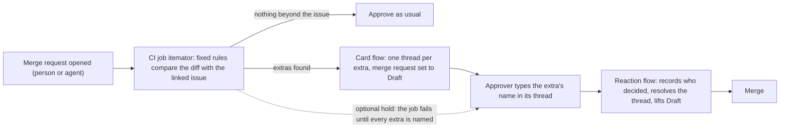

# Itemator

**An extra is a change a merge request makes that its issue never asked for, such as a new dependency. Itemator lists the extras, and none of them goes in until a person types an answer.**

*Life After Code, Path A, Assisted (a person approves every step). [MIT licence](LICENSE).* For teams that let coding agents open merge requests:

1. A CI job lists the extras with fixed rules, no model.
2. A GitLab Duo flow posts one thread per extra and sets the merge request to draft.
3. You answer in the thread: type the extra's name to keep it, or `split` or `remove` to move it out. A second flow reads the answers and lifts Draft when every extra has one; a person still approves the merge request.

[Try it in your browser, no login](https://showcase-3cd72e.gitlab.io/try/).

*Above: the card on a staged replay of the real example below. The job and both flows ran for real.*

**A real example.** In July 2025 GitHub Copilot opened a pull request in the Model Context Protocol's C# SDK to fix one deserialization bug, and also committed `dotnet-install.sh`, an install script the task never mentioned; a maintainer wrote "`@copilot` this file looks unnecessary, please delete it" ([the comment](https://github.com/modelcontextprotocol/csharp-sdk/pull/645#discussion_r2225905461)). Itemator's rules, frozen on 12 October, before we read any of these reviewer comments, list that file on their own. The picture above is that change replayed ([the thread](https://gitlab.com/gitlab-ai-hackathon/transcend-october-2026/39194174/second-project/-/merge_requests/2#note_4065417184)). There are [24 <!-- from: results/real_catches_v1.json:summary.read --> files like it](results/real_catches.md), each with the reviewer's words; the reviewer's comment came a median of 4.5 <!-- from: results/catch_timing_v1.json:summary.median_hours --> hours after the pull request opened ([two of them told as stories](results/stories.md)).

Why: on public pull requests that coding agents opened (Copilot, Codex, Devin, Cursor, Jules, Claude Code), Itemator's rules list at least one extra on 10,712 <!-- from: results/aidev_population_v6.json:summary.overall.with_an_extra --> of 71,582 <!-- from: results/aidev_population_v6.json:summary.readable --> ([population](results/aidev_population_v6.json)), about one in seven. In the example above a maintainer had to spot the install script by hand; with Itemator the merge request stays a draft until someone names it.

**Try it in three clicks, no login.**
1. [Paste a diff and its issue](https://showcase-3cd72e.gitlab.io/try/), or click an example: the page lists each package the issue does not name, as the CI job would, and runs three supply-chain checks too. Nothing you paste leaves it.
2. [The real example, start to finish](https://gitlab.com/gitlab-ai-hackathon/transcend-october-2026/39194174/second-project/-/merge_requests/2#note_4065417055) (a staged replay of #645 in a second project, October 22; the job and both flows ran for real). The page shows, in order (usernames left out):

   > **Card:** 1 <!-- from: results/replay_645_react_v1.json:extras --> thing beyond #2: `dotnet-install.sh` (stray file). The merge request is marked draft. 
   > **The author, in the `dotnet-install.sh` thread:** remove (what the real maintainer asked for) 
   > **Flow:** Removed: `dotnet-install.sh` taken out of this merge request by the author ([commit](https://gitlab.com/gitlab-ai-hackathon/transcend-october-2026/39194174/second-project/-/commit/c6e77871f9abc25c80250d87616a7790d4d5be4b)). It resolves the thread and marks the merge request ready. 
   > **Flow:** Every extra has an answer ([summary](https://gitlab.com/gitlab-ai-hackathon/transcend-october-2026/39194174/second-project/-/merge_requests/2#note_4066468298)).

   Two faults show, left as they happened: GitLab dropped the first flow session, and the same reply typed again worked; the thread names showcase's reaction account, because that project's job was set to name its own only later that day ([the fix](https://gitlab.com/gitlab-ai-hackathon/transcend-october-2026/39194174/second-project/-/commit/f24deb08)).

   Here the card also starts by itself, and `split` moves a file out: [!10](https://gitlab.com/gitlab-ai-hackathon/transcend-october-2026/39194174/showcase/-/merge_requests/10#note_3993186796) ([record](results/mr10_transcript.json)).

3. [What shipped](https://showcase-3cd72e.gitlab.io/): each merge to main, its extras, and who named each.

**What it needs.**
- GitLab Premium or Ultimate with the Duo Agent Platform, for the two flows.
- The project setting "All threads must be resolved". Without it an unanswered extra still marks the merge request as draft, but the merge button stays on.
- Optional, Ultimate only: a policy that runs the check from outside the project, so a merge request cannot edit it. Linking the policy takes an Owner once.
- For a merge request a coding agent opened, a person assigns the card account as reviewer. GitLab starts no flow from a bot's pipeline ([its docs](https://docs.gitlab.com/user/duo_agent_platform/triggers/)), so the card cannot start by itself there.

It runs on this public project, and on [a second one](https://gitlab.com/gitlab-ai-hackathon/transcend-october-2026/39194174/second-project) without the policy. [Setup](docs/setup.md).

**Answers from outside the project.** Every other answer here came from the owner's accounts. On !278 we asked one person who had not seen the project (they made a GitLab account for it; the rules, written before the card, are in [eval/outside_answer_rubric.json](eval/outside_answer_rubric.json)). They kept the extra and said why in their own words: [their reply](https://gitlab.com/gitlab-ai-hackathon/transcend-october-2026/39194174/showcase/-/merge_requests/278#note_4055666063), [the note on the issue](https://gitlab.com/gitlab-ai-hackathon/transcend-october-2026/39194174/showcase/-/issues/81). Raw record: [results/outside_answer_live.json](results/outside_answer_live.json). In a second test, registered before we asked anyone, people from the hackathon's Discord each review one merge request with the same planted changes, with or without Itemator; the first reviewer, with it, asked to remove the planted package ([so far](docs/measurements.md#reviewers-from-outside-the-project-still-open)).

### In numbers

| Question | Answer |
|---|---|
| Have real reviewers objected to files an AI agent changed that the rules also name? | Yes: 24 <!-- from: results/real_catches_v1.json:summary.pairs --> files in public agent pull requests, named by rules frozen on 12 October, before we read any of these comments (16 to 17 October). In 18 <!-- from: results/real_catches_readings.json:summary.asks_to_take_it_out --> the reviewer asks to take the file out ([read by one model](results/real_catches_readings.json)); 16 <!-- from: results/real_catches_v1.json:summary.did_not_land --> of the 24 <!-- from: results/real_catches_v1.json:summary.pairs --> did not land ([every case](https://showcase-3cd72e.gitlab.io/catches/)) |
| Does it stay quiet when there is nothing to ask? | On merge requests GitLab's own Duo Developer Flow merged into gitlab-org/gitlab in September 2026, it spoke on 9 <!-- from: results/public_replay_a1.json:G.agent.flagged --> of 84 <!-- from: results/public_replay_a1.json:G.agent.scored --> and stayed silent on the rest; on merge requests people wrote there, 9 <!-- from: results/public_replay_a1.json:G.merged.flagged --> of 96 <!-- from: results/public_replay_a1.json:G.merged.scored -->. Two model labellers found a clear extra in none of the agent ones it spoke on (0 <!-- from: results/public_replay_labels.json:per_merge_request.G_flagged.strict -->): most deleted tests along with the feature flag they cover, as GitLab's docs ask, so each cost one typed reply. ([replay](results/public_replay_a1.json), [more](docs/background.md)) |
| What does a merge request cost? | The check job makes no model call; the card flow makes about 6 <!-- from: results/cost_per_run.json:card_run_model_calls.typical --> ([cost](results/cost_per_run.json)) |

Every other number, with what it does not show, the real runs and each check the card can add: [docs/measurements.md](docs/measurements.md#the-front-pages-numbers-in-full).

**What it names.** A new dependency, a CI or config file, deleted or weakened tests, a removed public function, a binary file, a git hook, and a file that instructs coding agents. An issue can list what a change may touch (an `itemator-scope` block); then anything outside it is an extra. The card also states facts that ask nothing, such as shapes seen in supply-chain attacks ([every check](docs/measurements.md#at-a-glance-every-check-in-one-table)).

Compared with a check that fails the pipeline, and the policy job

**Compared with a check that fails the pipeline.** Such a check decides for everyone, and its reason is a log line. Itemator leaves each extra to a person and keeps that person's answer and reason in [a public log](https://showcase-3cd72e.gitlab.io/answers/), where the next merge request that adds the same file finds it. Each card also says what finding the facts cost.

**What it looks like.** The card is the picture near the top (fixed two lines, then one thread on the changed line). Here, a pipeline where the `itemator` job comes from a policy, not from the project's own CI file (the shield badge).

**Entered for Most Environmentally Impactful.** Each new dependency's thread says what it downloads on every fresh install, so a reviewer can say no before the bytes ship; and the check's own job moved to a much smaller image, which cut its own footprint per run. How both were measured, and what they do not show: [docs/background.md](docs/background.md) and [docs/measurements.md](docs/measurements.md).

## How it works

1. **A CI job lists the extras.** The `itemator` job reads the merge request's diff and its linked issue and applies fixed rules (`itemator/extras.py`): a new dependency, a CI or config change, removed tests, a removed public function, deleted generated code, a committed binary, large file or build output, a version bump, a stray file. No model decides whether an extra exists. It writes `itemator.json`.
2. **A GitLab Duo flow posts the card.** `flows/itemator_card.yml` starts by itself when the pipeline of a merge request a person opened finishes. In our runs GitLab did not start the flow from the pipeline of a merge request an agent opened, and its [trigger documentation](https://docs.gitlab.com/user/duo_agent_platform/triggers/) says why: every trigger needs a human to perform the action, and a bot or service account cannot start one. So for such a merge request, a person assigns the card account as reviewer, which is a normal reviewer step. The card is two lines: what is beyond the issue, and what the approver does next. Each extra gets its own resolvable thread on the line it changed, and the merge request is set to Draft. The flow's model also reads that file's diff and adds one sentence on what the file does, so the approver can answer without opening it; the fixed rules decide what is an extra, the model only describes it, and the thread says the sentence is the model's reading to check ([a staged check](https://gitlab.com/gitlab-ai-hackathon/transcend-october-2026/39194174/showcase/-/merge_requests/313): it described an install script and flagged a note written to sway automated reviewers without repeating it).
3. **The approver answers in the thread** with one word each: the extra's exact name keeps it, `not an extra` dismisses it, `split` moves a CI or config file or a package manifest into its own merge request, `remove` takes it back out of this one (like `split`, only for whole CI or config files, or a manifest whose only change is the named package; `remove` also takes back a file the merge request adds). The thread offers only the answers the flow accepts for that extra. `flows/itemator_react.yml` reads the answers when someone mentions its account or marks the merge request ready. It records who typed what, reopens a thread that was resolved without a name, and takes Draft off when every extra is settled. Its summary lists each extra with who decided, and says so when the author typed every answer. It also leaves a note on the issue the merge request closes, listing each extra and who decided it, so the plan records what was done beyond it ([issue #79](https://gitlab.com/gitlab-ai-hackathon/transcend-october-2026/39194174/showcase/-/issues/79), from the live run of 2026-10-20; also [#75](https://gitlab.com/gitlab-ai-hackathon/transcend-october-2026/39194174/showcase/-/issues/75) and [#55](https://gitlab.com/gitlab-ai-hackathon/transcend-october-2026/39194174/showcase/-/issues/55)).

Another checker's findings can use the same threads

Set `ITEMATOR_OTHER_CHECKER` ([setup](docs/setup.md)). Itemator's own rules ask only about kinds of change that need a person's choice, so on the 587 <!-- from: results/combined_v1.json:cases --> files reviewers objected to they name 27 <!-- from: results/combined_v1.json:named.itemator -->, fewer than two free checkers that also flag ordinary code files. Their findings can open the same threads: with Overreach's, 75 <!-- from: results/combined_v1.json:named.itemator_with_overreach --> of those files get a question ([measurements](docs/measurements.md)).

**What was decided before comes along.** If someone already answered an extra with the same name, in this project or in another one whose public answer log it reads, the thread says who decided what, where and when, read from the public answer log only when its hash chain holds; when earlier answers disagree, it names those merge requests too. In a second project the thread for a stray file said showcase had removed it, and that an earlier answer there kept it ([thread](https://gitlab.com/gitlab-ai-hackathon/transcend-october-2026/39194174/second-project/-/merge_requests/1#note_4065276875)). A person there still types the answer; we typed `remove`, and that project's own reaction flow took the file out and lifted Draft ([summary](https://gitlab.com/gitlab-ai-hackathon/transcend-october-2026/39194174/second-project/-/merge_requests/1#note_4065942500)).

It covers three moments: while an agent writes the change (a skill tells it to stay inside the issue and to say what it could not avoid), when a person reviews it (the card and one thread per extra), and after the merge (a note on the issue and a page of what shipped, with who decided).

On your own machine, with no GitLab and no model: `python -m itemator.local --issue issue.txt`, or `python -m itemator.local --commits --map` for an agent's local commits.

The remaining steps (registry facts, the description sentence, `always`, the optional hold, the asker rule, the decision log, the skills) and the live runs are in [docs/how-it-works.md](docs/how-it-works.md); the measurements and their limits are in [docs/measurements.md](docs/measurements.md). To install it in your own project, see [docs/setup.md](docs/setup.md).

## Background

The first run, the design choices, why now, and the related tools (some already compare a change with its issue or a declared scope): [docs/background.md](docs/background.md).

## Which lifecycle stages it touches
We count a stage only where Itemator reads or writes something in it:

| Stage | What Itemator does there | Open it |
|---|---|---|
| Plan | Reads the linked issue and checks the change against what it says | [the issue a card read](https://gitlab.com/gitlab-ai-hackathon/transcend-october-2026/39194174/showcase/-/issues/39) |
| Create | Reviews the merge request, opens one thread per extra, moves or removes an extra | [a merge request with its card, thread and summary](https://gitlab.com/gitlab-ai-hackathon/transcend-october-2026/39194174/showcase/-/merge_requests/45) |
| Verify | Runs as a CI job on every merge request pipeline; starts a Duo flow when it finishes. The same job also writes the extras as GitLab Code Quality findings (severity info, on each thread's line) and a Metrics report (`itemator/glreports.py`) | [pipelines](https://gitlab.com/gitlab-ai-hackathon/transcend-october-2026/39194174/showcase/-/pipelines), [the job's log](https://gitlab.com/gitlab-ai-hackathon/transcend-october-2026/39194174/showcase/-/jobs/17265337254) |
| Package | Looks up new dependencies on their public registries (PyPI, npm, crates.io, the Go module proxy; NuGet for packages added in .NET project files, shown beside the extras); a deployment job also uploads the checker to this project's package registry | [package registry](https://gitlab.com/gitlab-ai-hackathon/transcend-october-2026/39194174/showcase/-/packages) |
| Secure | Shows advisories and licences for new dependencies; flags committed binaries and build output; GitLab's secret detection and SAST templates run on every merge request pipeline; the card's own checks name lines of shapes that have carried attacks and strangers' text run in CI (on 31 <!-- from: results/advisory_holdout_v2.json:cases --> published advisories set aside before the rule was written, its first version named 10 <!-- from: results/advisory_holdout_v1.json:caught --> and its second version, written after we knew that result, 15 <!-- from: results/advisory_holdout_v2.json:caught -->) | [held-out advisory replay](results/advisory_holdout_v2.json), [SAST job](https://gitlab.com/gitlab-ai-hackathon/transcend-october-2026/39194174/showcase/-/jobs/17266699652) |
| Configure | Reads a team policy from the target branch; the flows and skills are set up per project; the deploy job runs in a `resource_group` (two merges deploy one after the other) and reads a variable scoped to the `production` environment | [team policy file](.itemator.toml), [deploy log](https://gitlab.com/gitlab-ai-hackathon/transcend-october-2026/39194174/showcase/-/jobs/17266699659) |
| Govern | Records who decided each extra; the policy can require a second person. The check itself is injected by a pipeline execution policy, so a merge request cannot edit or skip it (a push straight to the default branch still can; see [Known limits](#known-limits)): 0 <!-- from: results/bypass_matrix_v2.json:merged --> of 11 <!-- from: results/bypass_matrix_v2.json:attempts --> bypass attempts merged; 9 <!-- from: results/bypass_matrix_v2.json:blocked_by_the_itemator_job --> failed the check itself (in three of those the unit tests failed too, so those three would have been stopped anyway) and the other two were stopped by GitLab refusing a second job with the same name | [bypass attempts](results/bypass_matrix_v2.json), ["triggered by policy" in a job log](https://gitlab.com/gitlab-ai-hackathon/transcend-october-2026/39194174/showcase/-/jobs/17265337254) |
| Release | Every push to the default branch records a deployment of a `production` environment, uploads the checker as a package version, and publishes a page of what shipped in it (only merge requests are listed; a commit pushed straight to the branch has none): the merge requests, their extras and who named each ([live page](https://showcase-3cd72e.gitlab.io/), written by `itemator/shipped.py` from GitLab's own deployment records); the same push rebuilds [the answer log](https://showcase-3cd72e.gitlab.io/answers/) (`itemator/answerlog.py`): every recorded answer, each entry carrying the SHA-256 of the one before, built on the copy the site published last, so a later edit or deletion shows; on a tag, the `decision-log` job writes the same kind of section into that release's description | [release with its decisions](https://gitlab.com/gitlab-ai-hackathon/transcend-october-2026/39194174/showcase/-/releases/v0.1.0-rc1), [live page](https://showcase-3cd72e.gitlab.io/) |
| Monitor | The same job, run by hand for any window, reports how extras were decided (kept, dismissed, moved, removed) and how many names the merge request's own author typed alone. It watches the review process, not a running service. The `scan-history` job runs the same rules over merge requests already merged. After each page publish on the default branch, the `pages-smoke-check` job fetches the published pages and fails if one does not answer | [scan-history run](https://gitlab.com/gitlab-ai-hackathon/transcend-october-2026/39194174/showcase/-/jobs/17231250573), [pages check](https://gitlab.com/gitlab-ai-hackathon/transcend-october-2026/39194174/showcase/-/jobs/17266699661) |

That touches each of the nine stages the organisers list, and we claim no more than the table says. Monitor is the thinnest: one read-only report and a check that the published pages answer. Release is a package upload, a deployment record and a generated page, added on 2026-10-15. After each deployment one job checks that the published pages answer; nothing watches them continuously.

## Known limits
- **The flow triggers are switched off outside our own runs.** Each run uses Duo usage that is billed to the project, so a visitor who opens a merge request here will not see a card; the video and the results files show full runs. They stay off after the submission deadline until the winners are announced, as the hackathon's rules ask.
- **The forward test is not read yet.** On 2026-10-21 we sealed 60 <!-- from: results/prospective_v1_sealed.json:summary.pull_requests --> agent pull requests that were open on GitHub, with the 245 <!-- from: results/prospective_v1_sealed.json:summary.listed_files --> files the frozen rules list in them ([results/prospective_v1_sealed.json](results/prospective_v1_sealed.json); the list's SHA-256 is `1281919d8262256d45363f315cc74afe4e54023a4d1e855fba59dc150ed38647`). It asks the question past data answered against us: on agent pull requests with reviewer comments, files the rules listed drew an objection less often than files they did not (24 <!-- from: results/aidev_lift_v6.json:summary.main.listed.objected --> of 2,023 <!-- from: results/aidev_lift_v6.json:summary.main.listed.files --> against 479 <!-- from: results/aidev_lift_v6.json:summary.main.unlisted.objected --> of 12,078 <!-- from: results/aidev_lift_v6.json:summary.main.unlisted.files -->; two pull requests hold about half the listed files, [results/aidev_lift_v6.json](results/aidev_lift_v6.json)). On 2026-10-25 a script reads whether a reviewer objected to those files, whether they left the pull request, or whether they merged with no objection ([eval/prospective_rubric.json](eval/prospective_rubric.json)). The sentence for every possible result, a bad one included, is already committed ([eval/prospective_sentences.json](eval/prospective_sentences.json)): the script picks one by a fixed rule, fills in the counts and puts it here word for word, so the listed files count as ahead only if reviewers acted on a larger share of them than of the files the rules did not list. Until then we have no forward result.
- **Rules miss things.** For example, a one-line edit of a dependency list in `pyproject.toml` was missed until a live test found it (fixed in rules v4). The audits list more.
- **Anyone who can comment can answer.** On a public project any GitLab user can type a name or `not an extra`; only `split` and `remove` are limited to the author, assignees and reviewers.
- **A model follows the reaction steps.** Code decides which extras exist; the Duo model checks replies with the fixed string tests in `flows/itemator_react.yml`. It passed our live tests. We also wrote eight replies down first ([eval/react_study_cases.json](eval/react_study_cases.json): an exact name, a name in backticks with a full stop after a wrong reply, a dismissal, `remove`, a name in upper case, another thread's name, an instruction aimed at the flow, a name typed with the mention) and ran them once on a throwaway merge request: the flow ended as expected on 8 <!-- from: results/react_study.json:as_expected --> of 8 <!-- from: results/react_study.json:cases -->, including the three that had to stay open. A first list of thirteen, which also held a question and "keep it", was replaced before any run because the rules put stray files in one thread; a second round on a newer version of the flow put those two cases back and ended as expected on 8 <!-- from: results/react_study_round2.json:as_expected --> of 8 <!-- from: results/react_study_round2.json:cases -->. That is one run of one model on cases we wrote, so it is not a misread rate ([results/react_study.json](results/react_study.json)).
- **Typing is not reading.** We have not measured whether typing a name changes what approvers do. What it changes for certain is the record: each extra says who kept it. We have not measured how many real problems the rules miss; the table's row on what human reviewers called out of scope counts one kind of miss, and is not a recall figure.

The others, among them the policy and lock settings, the untested approved event and the narrow `split` and `remove`: [docs/limits.md](docs/limits.md).

## Where things are

The repository, folder by folder

| Folder | What is in it |
|---|---|
| `itemator/` | The checker: the rules, the CI job, the package facts and weights, the decision log and the generated pages |
| `ci/` | The job file the pipeline execution policy injects into every merge request pipeline |
| `flows/` | The two GitLab Duo custom flows: the card and the reaction |
| `skills/` | Two Agent Skills: one for an agent writing a change, one for answering a card |
| `web/` | The pages on GitLab Pages: try a diff, weigh a package, the picture of a change |
| `eval/` | Every study's script, each with the rubric written before it ran |
| `results/` | The output of each study: every number in this README points to one of these files |
| `tests/` | Unit tests, run in every pipeline; the mutation tests run from `eval/mutate_*.py` |
| `tools/` | The hardcode audit, the licence list and a smoke check of the published pages |
| `hf_runner/` | A small runner on a Hugging Face Space that runs the large-dataset studies next to the AIDev dataset |
| `docs/` | Setup, how it works, every measurement with its limits, Google Cloud, and [why the checker stays in Python](docs/why-python.md) |
| `examples/` | A made-up staged change (labelled as such) for the picture of a change, and a sample diff |

## Licence
MIT. See [LICENSE](LICENSE). The evaluation uses the AIDev dataset (CC BY 4.0), fetched by script and not redistributed; see [NOTICE](NOTICE).
